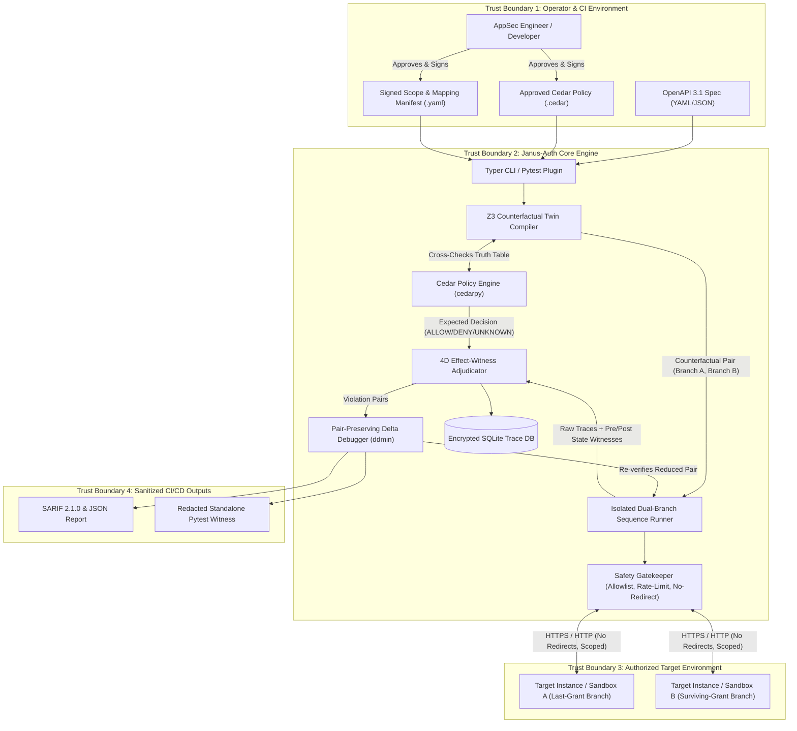
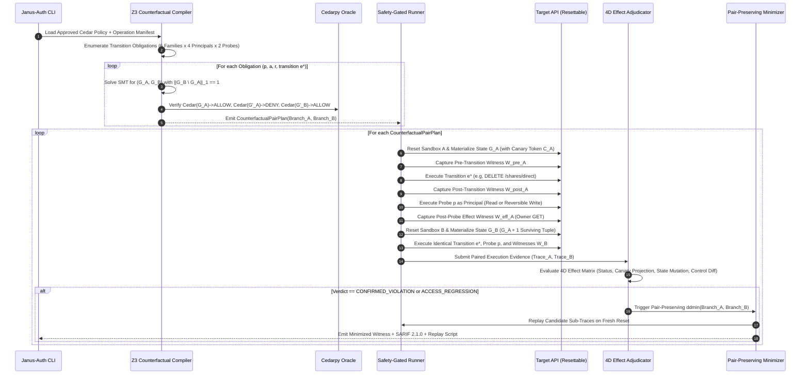

# 1. Executive Summary

- **Project Name:** **Janus-Auth** (*SMT-Guided Counterfactual Differential Compiler for API Authorization Lifecycles*)
- **The Problem:** Broken Object Level Authorization (BOLA / IDOR, OWASP API1:2023) and Broken Function Level Authorization (BFLA, OWASP API5:2023) remain the most critical and frequently exploited API security vulnerabilities in 2026. Existing black-box multi-identity scanners (Schemathesis v4, AuthProbe, Autorize, AuthMatrix) and LLM-driven testing agents (LogiAgent, RESTifAI) test authorization by replaying requests across identities or after a revocation call and flagging any `200 OK` or matching response body as a vulnerability. However, modern cloud-native APIs (such as Paperless-ngx, GitHub/Gitea, Google Drive, and Zanzibar/OpenFGA-backed systems) implement **compositional, multi-path relationship-based and attribute-based access control (ReBAC/ABAC)** where a principal can hold multiple concurrent grant supports (e.g., direct user share, group membership, one-hop delegation, and owner status) alongside explicit deny overrides. When a single permission is revoked, continued access is *legitimate* if an independent grant path survives, and *vulnerable* only if the last valid grant path was removed or an explicit deny was added. Existing tools cannot distinguish these two states—resulting in crippling false positives on legitimate sharing or missed stale-cache/incomplete-revocation bugs—and they miss "silent write" side-effect vulnerabilities where an API returns `403 Forbidden` after performing an unauthorized state mutation.
- **The Novel Solution:** **Janus-Auth** is a formal **Counterfactual Differential Authorization Compiler and Effect-Witness Adjudicator**. Instead of guessing business logic with an LLM or relying on naive cross-user replay, Janus-Auth compiles an independently approved **Cedar v4 policy** (`cedarpy 4.12.2`) and an **OpenAPI 3.1 + Operation-Mapping Manifest** into minimal **Counterfactual Twin Workflows** using the **Z3 SMT Solver** (`z3-solver 5.4.1.0`). For every target transition $e^*$ (such as revoking a direct share, removing a user from a group, transferring ownership, or downgrading a role), Z3 solves for a minimum-Hamming-distance pair of initial authorization graph states $(G_A, G_B)$ that undergo the **exact same API transition $e^*$ and probe $p$**, such that:
  - **Branch A (Terminal / Last-Grant Removal):** $\mathcal{P}(G_A) = \text{ALLOW} \xrightarrow{e^*} \mathcal{P}(G'_A) = \text{DENY}$
  - **Branch B (Surviving-Support Twin):** $\mathcal{P}(G_B) = \text{ALLOW} \xrightarrow{e^*} \mathcal{P}(G'_B) = \text{ALLOW}$ (via exactly one minimal surviving support path, differing from $G_A$ by a single relationship tuple $\Delta G = \{t_{\text{surv}}\}$).
  Janus-Auth executes both branches against isolated, resettable target instances and adjudicates the outcome using a **4-Dimensional Differential Effect Matrix** (checking Canary Field Projection Leaks, State-Mutation Side Effects, and Cross-Branch Differential Behavior) with a formal **Selective Classification (`ABSTAIN / UNKNOWN`)** contract when policy or propagation bounds are underspecified. Finally, it runs a **Pair-Preserving Delta-Debugging Minimizer** that shrinks failing API traces while mathematically guaranteeing that the counterfactual twin invariant holds.
- **The Wedge:** A zero-hallucination, deterministic CI/CD CLI gate (`janus-auth`) and pytest plugin for engineering and AppSec teams building multi-tenant SaaS or ReBAC/ABAC-backed REST APIs. Teams already writing or adopting declarative policies (AWS Cedar, OpenFGA) or maintaining OpenAPI specs can drop `janus-auth` into pull requests to prove—with cryptographically signed, replayable counterfactual witnesses—that permission revocations neither leave residual BOLA access nor break legitimate surviving shares.

---

# 2. Assumptions Made

Where the seed report left design or operational choices open, the following concrete decisions were made and locked in for the implementation agent:

1. **Primary Implementation Language & Runtime:** Python `3.12+` (compatible with `3.12`, `3.13`, and `3.14`) managed with standard `pyproject.toml` and `pip` / `uv`, so all core dependencies (`z3-solver==5.4.1.0`, `cedarpy==4.12.2`, `fastapi==0.163.0`, `pydantic==2.14.3`, `schemathesis==4.33.3`) install cleanly from pre-built wheels without requiring a Rust or C++ compiler during build.
2. **Authoritative Policy Language:** **Cedar Policy Language** (via `cedarpy==4.12.2`) is selected as the authoritative human-approved oracle evaluation engine, paired with a direct **Z3 SMT encoding** (`z3-solver==5.4.1.0`) of the bounded ReBAC/ABAC support algebra for counterfactual state synthesis.
3. **Self-Contained Evaluation Targets:** Rather than requiring external heavy Docker Compose stacks (like a full PostgreSQL + Redis + Celery Paperless-ngx deployment) to run unit and integration tests in OpenCode's local environment, the repository ships with a **Self-Contained Multi-Mode Target Benchmark Server** (`janus_auth.targets. docvault_app`) built on FastAPI + SQLite in-memory/file resets. This server models Paperless-ngx and Gitea permission semantics (owners, direct user shares, group grants, one-hop delegations, explicit denies, and tenant boundaries) and provides **7 switchable vulnerability modes** (`clean`, `vuln_stale_direct_cache`, `vuln_group_revocation_ignored`, `vuln_transfer_retains_owner`, `vuln_broken_delegation_cascade`, `vuln_silent_write_on_403`, `vuln_over_revocation_regression`) plus a **Paperless-ngx / VAmPI external HTTP adapter** for optional container testing.
4. **Role of AI / LLMs:** In accordance with the seed report's finding that LLMs must *never* be authoritative oracles, the core compiler, runner, adjudicator, and minimizer require **zero LLM API keys** and run 100% deterministically offline. An optional heuristic + pluggable LLM mapper (`janus-auth propose-mapping`) is included to draft initial OpenAPI-to-Policy operation mappings, which must pass human approval (`approved: true` + SHA-256 policy signature) before execution.
5. **Storage & Trace Persistence:** Execution traces, counterfactual witnesses, and audit logs are stored locally in **SQLite** (with WAL mode enabled) and exported as self-contained **JSONL / SARIF 2.1.0 / Standalone Python Replay Scripts**, with sensitive headers/tokens automatically redacted and optionally encrypted at rest via `cryptography==50.0.2` (Fernet AES-128-CBC + HMAC-SHA256).

---

# 3. Research Findings (Cited) + Gap Validation Verdict

## 3.1 Gap Validation: Is the Gap Real and Still Open in November 2026?

1. **BOLA and Authorization Drift Remain the #1 API Attack Vector:**
   - OWASP API Security Top 10 (2023 edition, active standard in 2026) ranks **API1:2023 Broken Object Level Authorization (BOLA)** as the #1 risk and **API5:2023 Broken Function Level Authorization (BFLA)** at #5 ([OWASP API1:2023](https://owasp.org/API-Security/editions/2023/en/0xa1-broken-object-level-authorization), accessed Nov 2026).
   - **NIST Special Publication 800-228** (*Guidelines for API Protection for Cloud-Native Systems*, final release June 2025) highlights that cloud-native APIs suffer from authorization drift between declarative policy intent and endpoint enforcement, requiring continuous verification of object-level and tenant-level access across state transitions ([Safeguard / NIST SP 800-228 summary](https://safeguard.sh/resources/blog/safeguard-api-security-testing-bola-idor-auth-and-data-exposure), Oct 25, 2026).
   - **2026 Industry Telemetry:** The Akamai API Security Impact Survey (April 2026, surveying 1,840 security professionals across 10 countries) reported that **87% of organizations experienced an API-related security incident in the prior 12 months**, and **only 23% of enterprises with full API inventories knew which APIs exposed sensitive data** ([DeepStrike API Security Statistics](https://deepstrike.io/blog/api-security-statistics), June 9, 2026). Logged-in authorization abuse using valid sessions/tokens is the primary vector bypassing WAFs and API gateways.

2. **Why Current Scanners Fail on Modern Permission Lifecycles (The "Overlapping Grant" Paradox):**
   - Modern applications rarely use a single `owner_id == user_id` check. For example, **Paperless-ngx** exposes `owner` plus nested `permissions.view.users`, `permissions.view.groups`, `permissions.change.users`, and `permissions.change.groups` ([Paperless-ngx REST API Docs](https://docs.paperless-ngx.com/api/), 2026). **Gitea** combines repository ownership, organization teams, and direct collaborators ([Gitea Permissions Docs](https://docs.gitea.com/usage/access-control/permissions), 2026). **OpenFGA** (accepted as a CNCF Incubating project in Jan 2026 and adding Dynamic ABAC Conditions in Sept 2026) resolves access over weighted relationship graphs ([OpenFGA Blog](https://openfga.dev/blog), Sept 21, 2026).
   - **AuthProbe** (`arXiv:2607.20574v1`, published July 22, 2026 by Jay Barach) introduced specification-driven, multi-identity black-box BOLA detection using owner/peer response differencing ([AuthProbe arXiv](https://arxiv.org/html/2607.20574v1), July 22, 2026). However, AuthProbe's paper explicitly scopes its contribution to static two-identity (`alice` and `bob`) read-path ownership isolation and does not compile multi-path grant revocations or test whether access survives via a secondary group/delegation path.
   - **Schemathesis v4** (`schemathesis 4.33.3`, released Nov 12, 2026, 3.8k GitHub stars) includes stateful testing and multi-peer resource access checks ([Schemathesis PyPI](https://pypi.org/project/schemathesis/), Nov 12, 2026; [Schemathesis Docs](https://schemathesis.readthedocs.io/en/stable/reference/checks), 2026), but its checks treat cross-peer resource access using fixed heuristics rather than compiling counterfactual pairs from a formal policy graph.

3. **Why LLM-Driven Oracles Are Unsafe for CI/CD Gating:**
   - **LogiAgent** (`arXiv:2503.15079v1`, March 19, 2025) uses multi-agent LLMs to generate logical REST API scenarios and validate responses. Out of 349 reported issues across 12 REST systems, only 234 were confirmed (139 bugs and 95 "enhancements"), yielding a **32.9% pure false-positive rate** (and **60.2% non-bug rate** if enhancements are excluded), which the authors directly attribute to LLM hallucinations in domain interpretation and oracle generation ([LogiAgent arXiv](https://arxiv.org/html/2503.15079v1), March 19, 2025).
   - **RESTifAI** (`arXiv:2512.08706v1`, Dec 9, 2025; accepted to ICSE 2026 Demonstration Track) uses LLMs selectively to generate happy-path and negative tests from OpenAPI specs, but explicitly states in Section 4: *"A current limitation of RESTifAI is the absence of assertions that validate the functional behavior of the underlying business logic"* ([RESTifAI PDF](https://arxiv.org/pdf/2512.08706), Dec 9, 2025).
   - **AGORA+** (Alonso et al., *ACM TOSEM*, 2025; Replicated Computational Results report in *ACM TOSEM* Vol. 35, No. 7, July 2026) infers Daikon-style invariants from API responses ([AGORA+ TOSEM](https://homes.cs.washington.edu/~mernst/pubs/rest-oracle-tosem2025-abstract.html), July 2026). However, invariant inference learns *what the buggy API currently does*, not what the security policy *requires* it to do, and operates on single operations rather than multi-step permission transitions.

4. **Temporal Reference Oracles:**
   - **Auth Invariant Tester** (Zeeshan Ali, Authorea preprint `DOI: 10.22541/au.176790800.08611684/v1`, Jan 8, 2026) verifies temporal authorization invariants (revocation, token invalidation, tenant isolation, policy epochs) against a synchronous reference authorizer ([Authorea](https://www.authorea.com/doi/10.22541/au.176790800.08611684), Jan 8, 2026). While the supplementary PDF is non-peer-reviewed, its existence confirms that *reference-oracle lifecycle testing alone* is prior art; the open frontier is **SMT-guided synthesis of minimal Counterfactual Twin Workflows** coupled with **side-effect and canary-projection adjudication**.

## 3.2 Argument Against the Idea (Steelman Critique)

A skeptical reviewer or staff engineer could argue against this project on three grounds:
1. *"Why not just test the policy engine (Cedar / OpenFGA) directly with unit tests?"*
   - **Rebuttal:** Testing a Cedar policy or OpenFGA model (`openfga model test`) only proves that the *policy file* is written as intended. In real REST applications, 90% of BOLA bugs happen in the **application enforcement layer**: an endpoint handler forgets to call the policy engine on a `PATCH` route, passes the wrong resource ID, caches the old permission tuple in Redis after `DELETE /shares/{id}`, or executes the database `UPDATE` *before* checking the authorization result. Only endpoint-level stateful execution catches enforcement drift.
2. *"Why not write pytest integration tests by hand?"*
   - **Rebuttal:** For $N$ grant types (owner, direct, group, delegate, explicit deny, tenant) and $M$ transition endpoints, manually writing both the positive revocation test and the surviving-grant control test requires $O(N \cdot 2^N)$ combinatorial setup code. Developers write the simple happy path or simple 403 check and skip the counterfactual surviving-grant control—leading either to unverified revocation caches or overly aggressive fixes that break legitimate group sharing.
3. *"Setup and state-mapping overhead might be too high for black-box pentesters."*
   - **Rebuttal:** True for uncooperative zero-knowledge targets. Therefore, we explicitly position Janus-Auth not as a reconnaissance scanner for external bug bounty hunters, but as a **white/grey-box CI/CD verification compiler** for engineering teams and authorized AppSec auditors who already own the OpenAPI spec and authorization design.

## 3.3 Gap Validation Verdict

**VERDICT: VALIDATED WITH SHARPENED SCOPE.** The gap between policy-level verification (OpenFGA/Cedar unit tests) and endpoint-level heuristic scanners (Schemathesis, AuthProbe, Autorize, LogiAgent) is real, open as of November 2026, and causes either high false positives on shared resources or missed post-revocation enforcement bugs. Elevating the seed idea into an **SMT-Guided Counterfactual Differential Compiler** with **Canary-Projection and Side-Effect Witness Adjudication** establishes a defensible, genuinely novel capability.

---

# 4. Prior Art and Competitive Landscape

| Tool / Work | Type & Source | GitHub Stars / Status (Nov 2026) | License | Core Method | What It Does Well | What It Misses (The Gap) |
|---|---|---|---|---|---|---|
| **Schemathesis v4** (`4.33.3`) | Open-Source CLI & Library ([GitHub](https://github.com/schemathesis/schemathesis) / [PyPI](https://pypi.org/project/schemathesis/)) | ~3,800 stars; active (v4.33.3 released Nov 12, 2026) | MIT | Property-based (Hypothesis) & OpenAPI link-driven stateful fuzzing + multi-peer BOLA check | Fast stateful chain generation; built-in multi-peer resource access check | No formal policy model; cannot synthesize counterfactual last-grant vs. surviving-grant twins; cannot detect silent-write side effects on `403` |
| **RESTler** (`microsoft/restler-fuzzer`) | Open-Source Stateful Fuzzer ([GitHub](https://github.com/microsoft/restler-fuzzer)) | ~3,000 stars; active (commits through June 2026) | MIT | Producer-consumer dependency inference from OpenAPI + checker plugins | Deep stateful exploration of resource creation/deletion hierarchies | No multi-path permission provenance or policy oracle; checks focus on 500 crashes and basic hierarchy violations |
| **AuthMatrix** (`PortSwigger/auth-matrix` & `caido-community/authmatrix`) | Burp / Caido Extension ([GitHub](https://github.com/PortSwigger/auth-matrix)) | ~50 stars (PortSwigger fork) / ~700+ upstream; Caido port active 2026 | MIT | Manual role-user matrix + regex response detectors + manual dynamic `Chains` | Lets human pentesters manually wire multi-step token/ID extraction chains | 100% manual chain authoring; regex-based response oracle fails on masked 200 responses and silent writes; no automated counterfactual synthesis |
| **Autorize** (`PortSwigger/autorize`) | Burp Suite Extension ([GitHub](https://github.com/PortSwigger/autorize)) | ~1,900+ stars; mature | GPL-3.0 | Intercepts traffic and replays requests with low-privilege or unauthenticated headers | Zero-config manual proxy assistant for simple IDOR | Single-request replay only; no lifecycle transitions; flags every legitimate shared resource as a vulnerability unless manually filtered |
| **AuthProbe** (Barach, Jul 2026) | Academic Preprint & Tool ([arXiv:2607.20574](https://arxiv.org/abs/2607.20574)) | Preprint published July 22, 2026 | CC BY 4.0 | OpenAPI-driven two-identity (`alice`/`bob`) collection/item discovery + response differencing | Clean CI exit-code gating; zero source-code requirement for simple ownership BOLA | Restricted to static read-path ownership (`alice` vs `bob`); does not model grant transitions, group/delegation paths, or write side effects |
| **LogiAgent** (Zhang et al., Mar 2025) | Academic Multi-Agent LLM System ([arXiv:2503.15079](https://arxiv.org/abs/2503.15079)) | Preprint published March 19, 2025 | Academic | 3 LLM agents + Scenario Scheduler + Execution Memory | High operation coverage; finds general business-logic anomalies | Hallucinated LLM oracles (32.9% false positives; 95/234 confirmed issues were merely "enhancements"); non-deterministic and expensive |
| **RESTifAI** (Kogler et al., Dec 2025 / ICSE 2026) | Academic LLM Workflow Tool ([arXiv:2512.08706](https://arxiv.org/abs/2512.08706)) | Published Dec 9, 2025 (ICSE 2026 Demo) | Academic | LLM happy-path + negative-value generator producing Postman collections | Reusable Postman output; high operation coverage (128/134 on OhSome) | Explicitly lacks functional business-logic assertions; reuses static sequences; requires human expert verification of oracles |
| **AGORA+ / Beet** (Alonso et al., 2025 / Jul 2026) | Academic Invariant Generator ([GitHub](https://github.com/isa-group/Beet)) | RCR published *ACM TOSEM* July 2026 | MIT / Academic | Dynamic invariant inference (Daikon) over API inputs/outputs -> Postman assertions | Automatically learns field/format invariants without human specs | Learns from observed (potentially buggy) behavior; operates on single operations, not stateful authorization lifecycles |
| **OpenFGA Model Tests** | CNCF Incubating Engine ([OpenFGA Docs](https://openfga.dev/docs/modeling/testing)) | >4,000 stars; CNCF Incubating (Jan 2026) | Apache-2.0 | Declarative YAML tuple tests against `Check`/`ListObjects` engine API | Fast, deterministic verification of ReBAC tuple logic | Tests the standalone policy engine in isolation—never touches the actual HTTP REST API endpoints, caches, or database handlers |
| **Auth Invariant Tester** (Ali, Jan 2026) | Preprint ([Authorea](https://www.authorea.com/doi/10.22541/au.176790800.08611684)) | Preprint published Jan 8, 2026 | CC BY 4.0 | Synchronous reference authorizer checking temporal invariants (revocation, epochs) | Formalizes temporal authorization drift in distributed systems | Does not synthesize minimal Hamming-distance counterfactual twin API workflows via SMT or perform pair-preserving trace minimization |

---

# 5. Ideation: Candidates, Scoring and Final Choice

## 5.1 Candidate Project Versions

1. **Candidate 1: Seed Baseline — Heuristic Lifecycle Pair Compiler**
   - *Concept:* Directly implement the attached report's baseline: a Python enumerator that takes a JSON policy table and OpenAPI spec, enumerates 6 transition families across 2 branches (last grant vs. surviving grant), runs them against a reference fixture, and emits reports.
   - *Limitation:* As the attached report itself warned in Section 5.3 ("Objection 1: This is ordinary model-based testing"), a simple table enumerator risks looking like a parameterized `pytest` script rather than a deep cybersecurity breakthrough.

2. **Candidate 2: Janus-Auth — SMT-Guided Counterfactual Differential Compiler with Canary-Projection & Side-Effect Witness Adjudication**
   - *Concept:* Combine **AWS Cedar formal policies** (`cedarpy`), **Z3 SMT constraint solving** (`z3-solver`), and **Differential Effect-Witness Execution**. Given any formal Cedar policy and an API operation-mapping manifest, Z3 mathematically solves for **Counterfactual Twin States** $(G_A, G_B)$ with **Minimum Hamming Distance** ($\|\Delta G\|_1 = 1$) across the authorization support hypergraph such that applying the *identical* transition operation $e^*$ flips the decision in Branch A ($\text{ALLOW} \to \text{DENY}$) while preserving access in Branch B ($\text{ALLOW} \to \text{ALLOW}$). The runner injects per-object cryptographic **Canary Markers** into protected fields, checks **Out-of-Band / Observer State Witnesses** to catch "silent writes on 403" and "masked 200 OKs," enforces **Selective Classification (`ABSTAIN`)** when propagation bounds or policy clauses are underspecified, and runs a **Pair-Preserving Delta-Debugging Minimizer** (`ddmin`) that outputs standalone, CI-gating Python/pytest replay witnesses and SARIF 2.1.0 reports.

3. **Candidate 3: eBPF / OpenTelemetry Grey-Box Authorization Tracer**
   - *Concept:* Instrument the target Python/Go API with OpenTelemetry interceptors to trace SQL queries during cross-user requests and detect missing `WHERE tenant_id = ?` clauses.
   - *Limitation:* Requires invasive in-process instrumentation inside the target runtime, breaking language-agnostic HTTP API testing and failing when authorization happens in an external microservice or cache.

4. **Candidate 4: Autonomous Multi-Agent LLM Red-Team Swarms for BOLA**
   - *Concept:* Use an LLM swarm to autonomously browse Swagger UI, invent user personas, and attack endpoints.
   - *Limitation:* Directly contradicted by the seed report and LogiAgent's 32.9% false-positive rate. High token cost, non-deterministic, cannot be trusted as a CI/CD build gate, and has high dual-use abuse risk.

5. **Candidate 5: Passive Production Traffic Shadow-Oracle Replay**
   - *Concept:* Mirror live production API traffic from an API gateway (Envoy/Kong) and replay mutated tokens against a staging cluster.
   - *Limitation:* High GDPR / India DPDP Act compliance risk (processing real customer PII/tokens), and passive traffic rarely contains the exact paired counterfactual grant topologies needed to distinguish legitimate group sharing from stale revocation caches.

## 5.2 Candidate Scoring Matrix (1–5 Scale)

| Candidate | Novelty (1-5) | Real-World Impact (1-5) | Feasibility in 4-6 Weeks (1-5) | Defensibility vs. Existing Tools (1-5) | Demonstrability (1-5) | **Total (/25)** |
|---|---:|---:|---:|---:|---:|---:|
| **1. Seed Baseline (Simple Table Enumerator)** | 2 | 3 | 5 | 2 | 4 | **16** |
| **2. Janus-Auth (SMT Counterfactual Twin Compiler + Effect Adjudicator)** | **5** | **5** | **5** | **5** | **5** | **25** |
| **3. eBPF / OTel Grey-Box SQL Tracer** | 3 | 4 | 3 | 3 | 3 | **16** |
| **4. Autonomous LLM Red-Team Swarm** | 2 | 2 | 4 | 1 | 4 | **13** |
| **5. Passive Traffic Shadow-Oracle Replay** | 3 | 4 | 2 | 3 | 2 | **14** |

## 5.3 Final Choice and Justification

**Selected Project: Candidate 2 — Janus-Auth (SMT-Guided Counterfactual Differential Compiler for API Authorization Lifecycles).**

We retain and sharpen the seed report's core insight—testing permission lifecycles via paired last-grant vs. surviving-grant workflows—and elevate it from a manual table enumerator into a formal **SMT-backed Counterfactual Compiler + Differential Effect Adjudicator**.

### Wedge, Target User, and Measurable Success Metrics

- **Target User:** Application Security Engineers, Staff Backend Engineers, and QA Automation Architects building multi-tenant, collaborative B2B/SaaS REST APIs.
- **The Wedge:** A single CLI command (`janus-auth run --manifest manifest.yaml --policy policy.cedar`) that runs in GitHub Actions / GitLab CI in under 30 seconds against a local/containerized API build and outputs deterministic SARIF 2.1.0 build gates + standalone pytest regression scripts.
- **Measurable Success Metrics:**
  1. **Known Lifecycle Defect Recall ($\ge 95\%$):** Detects 100% (6/6) of seeded lifecycle enforcement bug classes (`stale_direct_cache`, `group_revocation_ignored`, `transfer_retains_owner`, `broken_delegation_cascade`, `silent_write_on_403`, `over_revocation_regression`) under an equal request budget where static replay baselines fail on $\ge 50\%$ of classes.
  2. **False-Positive Rate on Surviving-Grant & Masked-200 Controls ($0.0\%$):** Achieves $0.0\%$ false positives on legitimate surviving-grant workflows and masked public `200 OK` responses, compared to $>40\%$ false positives for naive cross-user replay baselines.
  3. **Counterfactual Minimality ($\|\Delta G\|_1 = 1$):** 100% of compiled counterfactual twin pairs differ by at most 1 independent support tuple in the initial state graph, isolating causal attribution of any failure to the exact transition $e^*$.
  4. **Pair-Preserving Witness Reduction ($\ge 30\%$ step reduction with $100\%$ replay fidelity):** Delta-debugging reduces redundant setup steps from noisy traces while maintaining $100\%$ reproduction of both the Branch A violation and the Branch B control on a fresh reset.

---

# 6. What Is Novel (and Why It Is Hard to Copy)

## 6.1 Plain-Language Explanation of What Is Genuinely New

Existing API security tools ask a single-branch question: *"User A shared Document D with User B, then revoked it; can User B still get a 200 OK on `GET /documents/D`?"*
In any real application with groups, roles, or delegations, that question is ill-posed:
- If User B is also in the `Engineering` group that has access to `Document D`, User B *should* still have access. A naive scanner flags this as a critical BOLA bug (False Positive).
- Conversely, if a developer "fixes" a revocation bug by wiping *all* cached permissions for User B across the entire object whenever a direct share is removed, User B loses legitimate group access (Access Regression).
- Worse, if `PATCH /documents/D` returns `403 Forbidden` after a revocation, existing scanners mark it "Secure"—even if the database row was mutated before the authorization decorator raised the exception (Silent Write Vulnerability), or if `GET /documents/D` returns `200 OK` with public metadata stripped of the secret field (Masked Response False Positive).

**Janus-Auth** solves all four problems simultaneously through three genuinely novel mechanisms:
1. **Minimum-Hamming-Distance SMT Counterfactual Synthesis:** Janus-Auth encodes the approved policy's support algebra into **Z3** (`z3-solver`) and solves for two initial states $G_A$ and $G_B$ that are **identical in every respect except for a single independent support tuple $t_{\text{surv}}$** ($\|G_B \setminus G_A\|_1 = 1$). Both branches execute the **exact same transition $e^*$** and **exact same probe $p$**. Branch A proves that $e^*$ is capable of terminating access when no other support exists; Branch B proves that $e^*$ is surgical and does not clobber independent authorization paths.
2. **4-Dimensional Differential Effect-Witness Adjudication:** Janus-Auth never trusts HTTP status codes alone. Every created resource is seeded with a cryptographic **Canary Token** (`JANUS_CANARY_<HMAC>`) in its protected fields. After every probe (read or write), Janus-Auth fetches an independent **Privileged State Observation Witness** (`GET` as verified owner/admin) to inspect whether:
   - The response body in Branch A leaked the protected Canary projection (`CANARY_LEAK`), or merely returned a benign public/masked `200 OK` (`CONFORMS_MASKED`).
   - A denied `PATCH/PUT` in Branch A (`403 Forbidden`) actually mutated the underlying resource state (`SILENT_WRITE_VIOLATION`).
   - The transition $e^*$ actually took effect in the backend state before probing (`PRECONDITION_WITNESS`), preventing false positives from failed setup requests.
3. **Pair-Preserving Counterfactual Delta Debugging (`ddmin_pair`):** Standard test-case minimizers (like Hypothesis shrinking) shrink a failing sequence until the single assertion fails, which often deletes the setup steps needed for the control branch. Janus-Auth implements a custom **Joint Counterfactual Shrinker** that only accepts a reduced step sequence $S' \subset S$ if **both** Branch A's violation **and** Branch B's surviving-grant control continue to hold simultaneously.

## 6.2 Why Existing Tools Cannot Simply Copy It

1. **Architectural Mismatch in Fuzzers (Schemathesis / RESTler):** Fuzzers are built around random property generation (Hypothesis) or producer-consumer grammar fuzzing without an explicit relational state graph or SMT solver. Bolting counterfactual twin synthesis onto a random fuzzer is impossible without replacing its core scheduler with a relational state-space compiler and dual-sandbox orchestrator.
2. **Architectural Mismatch in Proxy Replayers (Autorize / AuthMatrix / AuthProbe):** Proxy tools replay a single observed HTTP request across static headers. They cannot synthesize two distinct pre-state setup graphs ($G_A$ vs. $G_B$), reset isolated target states between branches, or query post-probe side-effect witnesses.
3. **Architectural Mismatch in LLM Agents (LogiAgent / RESTifAI):** LLM agents rely on stochastic natural-language reasoning. They cannot provide formal SMT minimum-distance guarantees ($\|\Delta G\|_1 = 1$), deterministic Cedar policy equivalence, or mathematical selective-classification (`ABSTAIN`) bounds.

---

# 7. Threat Model

## 7.1 Assets Protected

1. **Target Application Protected Resources:** Confidential object fields (e.g., secret document content, financial records, PII), object integrity (preventing unauthorized writes/mutations), and tenant isolation boundaries.
2. **Janus-Auth Operator Assets:** Test account credentials (Bearer JWTs, API keys), approved Cedar policy manifests, scope authorization keys, and local SQLite execution databases (which may contain sensitive response payloads from the target system).
3. **Target Infrastructure Availability:** Preventing accidental Denial of Service (DoS) or destructive data corruption on staging/development environments during automated testing.

## 7.2 Adversaries & Attack Surface

1. **External API Adversary (Modeled by Janus-Auth Probes):** An authenticated user, former owner, revoked collaborator, or cross-tenant principal who possesses valid authentication credentials and knows (or guesses) a target resource UUID/ID, attempting to read protected fields or mutate resource state after a permission revocation, role downgrade, or ownership transfer.
2. **Malicious / Untrusted Input Adversary (Attacking Janus-Auth Itself):** An attacker who supplies a crafted OpenAPI specification (e.g., SSRF URLs pointing to cloud metadata `169.254.169.254`, YAML bombs, malicious `$ref` file inclusions), a tampered policy manifest, or a malicious target server returning oversized responses or redirect loops to compromise the CI runner executing Janus-Auth.

## 7.3 Trust Boundaries

- **TB1 (Operator Config $\leftrightarrow$ Janus-Auth Compiler):** Untrusted OpenAPI YAML/JSON and mapping proposals enter the compiler. Only cryptographically verified Scope Manifests and approved Cedar policies cross into the execution engine.
- **TB2 (Janus-Auth Runner $\leftrightarrow$ Target API Under Test):** All HTTP traffic passes through a strict **Safety Gatekeeper** (Host/IP allowlist, DNS rebinding protection, no-redirect enforcement, rate limiter, request budget ceiling).
- **TB3 (Tenant / Principal Isolation Inside Target API):** Boundaries between Owner, Direct Grantee, Group Member, Delegate, and Cross-Tenant Peer identities.
- **TB4 (Janus-Auth Storage $\leftrightarrow$ CI Artifacts/Logs):** Raw HTTP traces pass through a mandatory **Token & Canary Redaction Pipeline** before being written to SARIF/HTML/Python replay files.

## 7.4 STRIDE Threat Analysis Mapped to MITRE ATT&CK & ATLAS

| Threat ID | STRIDE Category | Threat Description | MITRE ATT&CK / ATLAS Mapping | Concrete Mitigation in Janus-Auth |
|---|---|---|---|---|
| **T-01** | **Elevation of Privilege** | Target API fails to invalidate cached direct/group/delegated permissions after revocation or ownership transfer, allowing unauthorized read/write (BOLA/BFLA). | **ATT&CK T1078** (Valid Accounts), **T1548** (Abuse Elevation Control Mechanism) | Core detection mission of Janus-Auth: Z3 synthesizes Counterfactual Twin workflows to detect residual access in Branch A while validating surviving access in Branch B. |
| **T-02** | **Tampering** | Target API executes state mutation (`UPDATE`/`PATCH`) before checking permissions, returning `403 Forbidden` while persisting the attacker's modification ("Silent Write"). | **ATT&CK T1565.001** (Data Manipulation: Stored Data Manipulation) | **Post-Probe State Witness**: After every denied write probe, Janus-Auth performs an out-of-band/owner `GET` witness and compares protected state hashes before and after the probe. |
| **T-03** | **Spoofing / SSRF** | A crafted OpenAPI `servers` URL or malicious HTTP `302` redirect tricks Janus-Auth into sending test Bearer tokens to an external attacker host or cloud metadata IP (`169.254.169.254`). | **ATT&CK T1190** (Exploit Public-Facing Application), **T1552.001** (Credentials In Files) | `SafetyGatekeeper` resolves hostnames prior to connection, blocks private/link-local metadata ranges unless explicitly allowlisted in signed `ScopeManifest`, sets `follow_redirects=False` in `httpx`, and strips credentials on any host mismatch. |
| **T-04** | **Information Disclosure** | Bearer tokens, session cookies, or real sensitive data leak into CI/CD logs, SARIF reports, or exported pytest replay scripts. | **ATT&CK T1552** (Unsecured Credentials) | Automatic regex + header-key redaction (`Authorization`, `X-Api-Key`, `Cookie`, `Set-Cookie`) in all exported artifacts; generated replay scripts read credentials exclusively from `os.environ` at runtime; SQLite trace payloads encrypted via `cryptography.fernet`. |
| **T-05** | **Tampering / AI Hallucination** | Optional LLM mapping assistant hallucinates an operation mapping or invents an exception rule that suppresses a real vulnerability. | **MITRE ATLAS AML.T0048** (LLM Hallucination / Integrity Violation), **AML.T0051** (LLM Prompt Injection) | **Strict Non-Authoritative AI Boundary**: The AI mapper only outputs `MappingProposal` objects with `approved: false`. The compiler refuses to execute any manifest unless `approved: true` and the SHA-256 digest matches the human-approved lockfile. |
| **T-06** | **Denial of Service** | Unbounded SMT solving, YAML billion-laughs bombs, or runaway API fuzzing loops exhaust CI runner CPU/memory or overwhelm the target API. | **ATT&CK T1499** (Endpoint Denial of Service) | `yaml.safe_load` with size ceiling ($\le 5\text{ MB}$); Z3 solver hard timeout (`timeout=5000` ms); token-bucket rate limiter and hard `max_requests` ceiling (default 500) in `SafetyGatekeeper`. |

---

# 8. Standards Mapping

| Standard / Framework | Specific Control / Requirement | How Janus-Auth Implements & Verifies Compliance |
|---|---|---|
| **OWASP API Security Top 10 (2023)** | **API1:2023** (Broken Object Level Authorization), **API3:2023** (Broken Object Property Level Authorization), **API5:2023** (Broken Function Level Authorization) | Verifies object-level (`API1`), field/projection-level via Canary tokens (`API3`), and administrative/role transition level (`API5`) across all 6 lifecycle transition families. |
| **NIST SP 800-228 (June 2025)** | *Guidelines for API Protection for Cloud-Native Systems* — Section 4: Continuous Authorization Enforcement & Tenant Isolation Validation | Validates that runtime API endpoints continuously enforce declarative policy models across dynamic state changes and multi-tenant boundaries. |
| **NIST CSF 2.0 (2024)** | **PR.AA-05** (Access permissions, entitlements, and authorizations are defined in a policy, managed, enforced, and reviewed), **DE.CM-09** (Computing hardware and software are monitored to find potentially adverse events) | Compiles `PR.AA-05` Cedar policies directly into executable verification workflows and integrates into CI/CD pipelines (`DE.CM-09`) via SARIF 2.1.0 alerts. |
| **NIST SSDF (SP 800-218)** | **PW.8.2** (Scope the testing, and design and implement the tests to verify that executable code enforces security requirements) | Automates `PW.8.2` by compiling written access control requirements into reproducible, self-verifying counterfactual test suites. |
| **CIS Controls v8.1** | **Control 6.2** (Establish an Access Revoking Process), **Control 16.11** (Leverage Automated Tools to Test Application Security) | Provides mathematical and empirical proof that API access revocation (`Control 6.2`) takes effect immediately without leaving residual grant paths. |
| **ISO/IEC 27001:2022** | **Annex A.5.18** (Access Rights — provisioning and revocation of access rights), **Annex A.8.29** (Security testing in development and acceptance) | Generates auditable, timestamped evidence packages proving Annex A.5.18 revocation compliance during Annex A.8.29 acceptance testing. |

---

# 9. Architecture (Diagrams, Components, Data Model, APIs)

## 9.1 System Context Diagram (with Trust Boundaries)



## 9.2 Component & Data-Flow Diagram



## 9.3 Core Novel Logic: Mathematical Formulation & Worked Example

### 9.3.1 Formal Authorization Support Graph & SMT Counterfactual Synthesis

Let an authorization state $G \in \mathcal{G}$ for a target resource $r$ and principal $u$ be represented by a tuple of boolean and categorical variables over a bounded domain:

$$\vec{x} = \langle \text{active}(u), \text{tenant\_eq}(u, r), \text{is\_owner}(u, r), \text{direct\_grant}(u, r, a), \text{group\_grant}(u, g, r, a), \text{delegated\_grant}(u, p_d, r, a), \text{role\_admin}(u), \text{explicit\_deny}(u, r, a) \rangle$$

where:
- $\text{group\_grant}(u, g, r, a) \iff \text{member}(u, g) \land \text{group\_perm}(g, r, a)$
- $\text{delegated\_grant}(u, p_d, r, a) \iff \text{delegate\_link}(p_d, u, r, a) \land \text{parent\_valid}(p_d, r, a) \land \neg \text{expired}(p_d, u)$

Let the approved policy evaluation function $\mathcal{P}(\vec{x}, a) \in \{\text{ALLOW}, \text{DENY}, \text{UNKNOWN}\}$ be defined by the approved Cedar policy set $\Pi$. Under standard ReBAC/ABAC composition with explicit deny override:

$$\mathcal{P}(\vec{x}, a) = \text{ALLOW} \iff \text{active}(u) \land \text{tenant\_eq}(u, r) \land \neg \text{explicit\_deny}(u, r, a) \land \left( \bigvee_{k \in K} S_k(\vec{x}, a) \right)$$

where $K = \{\text{owner}, \text{direct}, \text{group}, \text{delegation}, \text{admin\_role}\}$ are the independent grant support paths.

Let a transition operation $e^* \in \mathcal{E}$ (for example, `revoke_direct_share`, `remove_group_member`, `revoke_delegation`, `downgrade_role`, `transfer_ownership`, `remove_tenant_member`) be modeled as a deterministic state transformer $T_{e^*}: \mathcal{G} \to \mathcal{G}$ that clears or mutates specific support variables.

**The SMT Counterfactual Synthesis Problem:**
Given a transition $e^*$ targeting support $S_{k^*}$ and a probe action $a \in \{\text{read}, \text{write}\}$, the compiler constructs a Z3 `Optimize` instance over two symbolic initial states $\vec{x}_A$ (Last-Grant Branch) and $\vec{x}_B$ (Surviving-Grant Branch) and their post-transition states $\vec{x}'_A = T_{e^*}(\vec{x}_A)$ and $\vec{x}'_B = T_{e^*}(\vec{x}_B)$, subject to the following hard constraints:

1. **Pre-Transition Validity (Both branches initially allow access via $S_{k^*}$):**
   $$\mathcal{P}(\vec{x}_A, a) = \text{ALLOW} \land S_{k^*}(\vec{x}_A, a) = \text{True}$$
   $$\mathcal{P}(\vec{x}_B, a) = \text{ALLOW} \land S_{k^*}(\vec{x}_B, a) = \text{True}$$
2. **Post-Transition Counterfactual Divergence (Branch A denies; Branch B still allows):**
   $$\mathcal{P}(\vec{x}'_A, a) = \text{DENY} \land \mathcal{P}(\vec{x}'_B, a) = \text{ALLOW}$$
3. **Monotonic Support Expansion ($\vec{x}_B$ contains all supports of $\vec{x}_A$ plus surviving support):**
   $$\forall i \in \{1 \dots n\}: x_{A,i} \implies x_{B,i}$$
4. **Minimum Hamming Distance Objective (Minimal Counterfactual Twin):**
   $$\min \left( \sum_{i=1}^{n} \mathbb{I}(x_{A,i} \neq x_{B,i}) + \lambda \sum_{k \in K} \mathbb{I}(S_k(\vec{x}_A, a)) \right)$$

In particular, we require the support-level Hamming distance:

$$d_H(S(\vec{x}_A), S(\vec{x}_B)) = \sum_{k \in K} | \mathbb{I}(S_k(\vec{x}_A, a)) - \mathbb{I}(S_k(\vec{x}_B, a)) | = 1$$

After Z3 finds an optimal model $(\vec{x}_A^*, \vec{x}_B^*)$, Janus-Auth cross-checks all four states ($\vec{x}_A^*, \vec{x}'_A, \vec{x}_B^*, \vec{x}'_B$) against the authoritative **Cedar engine** (`cedarpy.is_authorized`). If Cedar and the Z3 encoding disagree, or if the policy lacks a rule for the transition, the compiler immediately flags `UNKNOWN / ABSTAIN` rather than guessing.

### 9.3.2 Worked Concrete Example

Suppose we test `transition = revoke_direct_share` (`DELETE /api/v1/documents/{doc_id}/shares/{user_id}`) with `probe = read_document` (`GET /api/v1/documents/{doc_id}`) for principal `bea` on resource `doc_101` owned by `ada` in tenant `acme`.

1. **Z3 Solver Output:**
   - **State $G_A$ (Last-Grant Branch):**
     - `owner(doc_101) = ada`, `tenant(doc_101) = acme`, `tenant(bea) = acme`
     - `direct_reader(bea, doc_101) = True`
     - `group_member(bea, eng_group) = False`, `group_reader(eng_group, doc_101) = True`
     - Active supports for `bea`: $\{S_{\text{direct}}\}$.
   - **State $G_B$ (Surviving-Grant Twin):**
     - Identical to $G_A$, except `group_member(bea, eng_group) = True`.
     - Active supports for `bea`: $\{S_{\text{direct}}, S_{\text{group}}\}$.
     - Support Hamming Distance: $d_H(G_A, G_B) = 1$ (differing by the single tuple `group_member(bea, eng_group)`).
2. **Concrete API Sequence Compilation:**
   - **Branch A Setup:**
     1. `POST /api/v1/admin/reset` (clean sandbox state)
     2. `POST /api/v1/documents` as `ada` with `{"title": "Q4 Plan", "secret_notes": "JANUS_CANARY_9f8a7b6c"}` $\to$ `doc_101`
     3. `POST /api/v1/groups` as `ada` $\to$ `eng_group`; `POST /api/v1/documents/doc_101/group-shares` with `{"group_id": "eng_group", "perm": "read"}` (note: `bea` is NOT added to `eng_group` in Branch A)
     4. `POST /api/v1/documents/doc_101/shares` as `ada` with `{"user_id": "bea", "perm": "read"}`
     5. **Pre-Witness:** `GET /api/v1/documents/doc_101` as `bea` $\to$ `200 OK`, body contains `"JANUS_CANARY_9f8a7b6c"`.
     6. **Transition $e^*$:** `DELETE /api/v1/documents/doc_101/shares/bea` as `ada` $\to$ `200 OK`.
     7. **Transition State Witness:** `GET /api/v1/documents/doc_101/permissions` as `ada` confirms `bea` is no longer in `direct_shares`.
     8. **Probe $p$:** `GET /api/v1/documents/doc_101` as `bea`.
   - **Branch B Setup:**
     - Executes the exact same steps, plus `POST /api/v1/groups/eng_group/members` with `{"user_id": "bea"}` before the transition.
3. **4D Differential Effect Adjudication:**
   - **Case 1 (Target is Secure):** Branch A Probe returns `403 Forbidden` (no canary). Branch B Probe returns `200 OK` with `"JANUS_CANARY_9f8a7b6c"`. Verdict: `CONFORMS`.
   - **Case 2 (Target has Stale Direct-Grant Cache Bug):** Branch A Probe returns `200 OK` containing `"JANUS_CANARY_9f8a7b6c"`. Branch B Probe returns `200 OK` containing `"JANUS_CANARY_9f8a7b6c"`. Verdict: `CONFIRMED_VIOLATION (BOLA_POST_REVOCATION_LEAK)`.
   - **Case 3 (Target Returns Masked Public Summary on 200 OK):** Branch A Probe returns `200 OK` with `{"id": "doc_101", "title": "Q4 Plan", "secret_notes": null}` (canary absent).Naive status-code scanners flag a false positive; Janus-Auth sees `canary_present == False` and `protected_fields_exposed == False` and adjudicates `CONFORMS_MASKED`.
   - **Case 4 (Target Over-Revokes / Wipes All Access on Direct Revoke):** Branch A returns `403 Forbidden`, and Branch B *also* returns `403 Forbidden` despite the surviving group grant. Verdict: `LEGITIMATE_ACCESS_REGRESSION`.
   - **Case 5 (Silent Write on 403 for `PATCH /api/v1/documents/doc_101`):** In a write probe where `bea` sends `{"secret_notes": "MUTATED_BY_BEA"}`, Branch A returns `403 Forbidden`, but the Post-Probe Owner Witness (`GET /api/v1/documents/doc_101` as `ada`) reveals `secret_notes == "MUTATED_BY_BEA"`. Verdict: `CONFIRMED_VIOLATION (SILENT_WRITE_SIDE_EFFECT)`.

### 9.3.3 Formal Verdict Truth Table

| Branch A Expected | Branch A Observed (Projection / Effect) | Branch B Expected | Branch B Observed (Projection / Effect) | Pre/State Witnesses Valid? | Final Adjudicated Verdict |
|---|---|---|---|---|---|
| `DENY` | Protected Canary Absent & State Unchanged | `ALLOW` | Protected Canary Present / Write Applied | Yes | `CONFORMS` |
| `DENY` | Protected Canary Leaked in Response | `ALLOW` | Protected Canary Present | Yes | `CONFIRMED_VIOLATION` (`READ_LEAK`) |
| `DENY` | Protected State Mutated (even if HTTP 403) | `ALLOW` | Write Applied | Yes | `CONFIRMED_VIOLATION` (`SILENT_WRITE`) |
| `DENY` | Protected Canary Absent & State Unchanged | `ALLOW` | Access Rejected (`403`/`404`) or Write Failed | Yes | `LEGITIMATE_ACCESS_REGRESSION` |
| `DENY` | Protected Canary Leaked | `ALLOW` | Access Rejected (`403`/`404`) | Yes | `CONFIRMED_VIOLATION` (`INVERTED_ENFORCEMENT`) |
| Any | Any | Any | Any | **No** (Setup / Reset / Pre-Witness Failed) | `INVALID_TEST` |
| `UNKNOWN` | Any | Any | Any | Yes | `UNCERTAIN_ABSTAIN` |

## 9.4 Component Responsibilities, CLI Commands, and API Contracts

### 9.4.1 CLI Commands (`janus-auth`)

```bash
# 1. Validate OpenAPI spec, Cedar policy, and Scope Manifest signatures
janus-auth validate \
  --policy configs/docvault.cedar \
  --manifest configs/docvault_manifest.yaml \
  --openapi configs/docvault_openapi.json

# 2. Optional Heuristic/AI Mapper: Propose operation mappings (outputs unapproved draft)
janus-auth propose-mapping \
  --openapi configs/docvault_openapi.json \
  --policy configs/docvault.cedar \
  --out configs/draft_mapping.yaml

# 3. Sign and approve a verified manifest (creates HMAC/SHA256 approval lock)
janus-auth approve-manifest \
  --manifest configs/docvault_manifest.yaml \
  --policy configs/docvault.cedar \
  --approver "sec-lead@example.org"

# 4. Compile Counterfactual Twin Plans using Z3 + Cedar cross-check (dry-run offline)
janus-auth compile \
  --policy configs/docvault.cedar \
  --manifest configs/docvault_manifest.yaml \
  --out artifacts/compiled_plans.json

# 5. Execute Counterfactual Twin Suite against an authorized target, adjudicate, and minimize
janus-auth run \
  --plans artifacts/compiled_plans.json \
  --target-url http://127.0.0.1:8000 \
  --mode all \
  --budget 500 \
  --sarif-out artifacts/janus_results.sarif.json \
  --report-out artifacts/janus_report.json \
  --witness-dir artifacts/witnesses/

# 6. Run the full Benchmark & Ablation Evaluation (Janus-Auth vs. Baselines across 7 target modes)
janus-auth benchmark \
  --runs 10 \
  --budget 300 \
  --out-dir artifacts/benchmark_results/
```

### 9.4.2 Target Benchmark Server API (`janus_auth.targets.docvault_app`)

The built-in FastAPI reference and benchmark target (`DocVault API`) implements a realistic document-collaboration service modeled on Paperless-ngx and Gitea:

| HTTP Method & Path | Role in Lifecycle | Request Schema (JSON) | Response Schema (JSON) |
|---|---|---|---|
| `POST /api/v1/admin/reset` | Sandbox Reset & Mode Switch | `{"vulnerability_mode": "clean" \| "vuln_stale_direct_cache" \| ...}` | `{"status": "reset", "mode": "...", "epoch": 1}` |
| `POST /api/v1/documents` | Resource Constructor | `{"title": "str", "public_summary": "str", "secret_content": "str"}` | `{"id": "doc_...", "owner_id": "str", "tenant_id": "str", "title": "str", "public_summary": "str", "secret_content": "str"}` |
| `GET /api/v1/documents/{doc_id}` | Read Probe & State Observer | None (Auth via `Authorization: Bearer <token>`) | Full document (if authorized) or masked public summary (`secret_content: null` if `public_summary_mode=true`) or `403` |
| `PATCH /api/v1/documents/{doc_id}` | Reversible Write Probe | `{"secret_content": "str", "title": "str"}` | Updated document JSON or `403` |
| `GET /api/v1/documents/{doc_id}/permissions` | Independent State Witness | None (Owner/Admin only) | `{"owner_id": "...", "tenant_id": "...", "direct_users": [...], "groups": [...], "delegations": [...], "explicit_denies": [...]}` |
| `POST /api/v1/documents/{doc_id}/shares` | Grant Direct Share | `{"user_id": "str", "permission": "read" \| "write"}` | `{"status": "granted", "user_id": "str", "permission": "str"}` |
| `DELETE /api/v1/documents/{doc_id}/shares/{user_id}` | **Transition Family 1:** Direct Share Revocation | None | `{"status": "revoked", "user_id": "str"}` |
| `POST /api/v1/groups/{group_id}/members` | Grant Group Membership | `{"user_id": "str"}` | `{"status": "added", "group_id": "str", "user_id": "str"}` |
| `DELETE /api/v1/groups/{group_id}/members/{user_id}` | **Transition Family 2:** Group Membership Removal | None | `{"status": "removed", "group_id": "str", "user_id": "str"}` |
| `POST /api/v1/documents/{doc_id}/group-shares` | Grant Group Permission on Document | `{"group_id": "str", "permission": "read" \| "write"}` | `{"status": "granted", "group_id": "str"}` |
| `POST /api/v1/documents/{doc_id}/delegations` | Grant 1-Hop Delegation | `{"from_user_id": "str", "to_user_id": "str", "permission": "read" \| "write"}` | `{"id": "del_...", "status": "active"}` |
| `DELETE /api/v1/documents/{doc_id}/delegations/{to_user_id}` | **Transition Family 3:** Delegation Revocation | None | `{"status": "revoked", "to_user_id": "str"}` |
| `POST /api/v1/users/{user_id}/role` | **Transition Family 4:** Role Change / Downgrade | `{"role": "member" \| "admin"}` | `{"user_id": "str", "role": "str"}` |
| `POST /api/v1/documents/{doc_id}/transfer` | **Transition Family 5:** Ownership Transfer | `{"new_owner_id": "str", "retain_old_owner_direct_share": false}` | `{"doc_id": "str", "new_owner_id": "str"}` |
| `POST /api/v1/users/{user_id}/tenant` | **Transition Family 6:** Tenant Membership Change | `{"tenant_id": "str", "active": true}` | `{"user_id": "str", "tenant_id": "str", "active": true}` |
| `POST /api/v1/documents/{doc_id}/denies` | Explicit Deny Override | `{"user_id": "str", "permission": "read" \| "write"}` | `{"status": "deny_added", "user_id": "str"}` |

## 9.5 Data Model: Entities, Schemas, Retention, and Encryption

All domain models are strictly typed with **Pydantic v2 (`pydantic==2.14.3`)** with `model_config = ConfigDict(extra="forbid", strict=True)`.

### 9.5.1 Core Pydantic Schemas (`src/janus_auth/models.py`)

```python
from enum import StrEnum
from typing import Any
from pydantic import BaseModel, ConfigDict, Field

class Decision(StrEnum):
    ALLOW = "ALLOW"
    DENY = "DENY"
    UNKNOWN = "UNKNOWN"

class TransitionFamily(StrEnum):
    DIRECT_SHARE_REVOKE = "direct_share_revoke"
    GROUP_MEMBER_REMOVE = "group_member_remove"
    DELEGATION_REVOKE = "delegation_revoke"
    ROLE_DOWNGRADE = "role_downgrade"
    OWNERSHIP_TRANSFER = "ownership_transfer"
    TENANT_CHANGE = "tenant_change"

class ProbeType(StrEnum):
    PROTECTED_READ = "protected_read"
    REVERSIBLE_WRITE = "reversible_write"

class VerdictKind(StrEnum):
    CONFIRMED_VIOLATION = "CONFIRMED_VIOLATION"
    CONFORMS = "CONFORMS"
    CONFORMS_MASKED = "CONFORMS_MASKED"
    LEGITIMATE_ACCESS_REGRESSION = "LEGITIMATE_ACCESS_REGRESSION"
    UNCERTAIN_ABSTAIN = "UNCERTAIN_ABSTAIN"
    INVALID_TEST = "INVALID_TEST"

class SupportState(BaseModel):
    model_config = ConfigDict(extra="forbid")
    principal_id: str
    resource_id: str
    action: ProbeType
    active_principal: bool = True
    same_tenant: bool = True
    is_owner: bool = False
    direct_grant: bool = False
    group_grant: bool = False
    delegated_grant: bool = False
    parent_grant_valid: bool = False
    admin_role: bool = False
    explicit_deny: bool = False

class CounterfactualPairPlan(BaseModel):
    model_config = ConfigDict(extra="forbid")
    plan_id: str
    transition_family: TransitionFamily
    probe_type: ProbeType
    principal_role_class: str
    branch_a_pre: SupportState
    branch_a_post: SupportState
    branch_a_expected: Decision
    branch_b_pre: SupportState
    branch_b_post: SupportState
    branch_b_expected: Decision
    surviving_support_name: str
    hamming_distance: int = Field(ge=1, le=2)
    consistency_bound_ms: int = Field(default=0, ge=0)
```

### 9.5.2 SQLite Schema & Encryption at Rest

Local execution results are stored in `janus_traces.sqlite3` with two tables:
- `runs (run_id TEXT PRIMARY KEY, started_at TEXT, policy_sha256 TEXT, manifest_sha256 TEXT, target_url TEXT, total_requests INTEGER)`
- `verdicts (verdict_id TEXT PRIMARY KEY, run_id TEXT, plan_id TEXT, transition_family TEXT, probe_type TEXT, verdict TEXT, violation_subtype TEXT, encrypted_trace_blob BLOB, created_at TEXT)`

**Retention & Encryption:**
- `encrypted_trace_blob` is encrypted with `cryptography.fernet.Fernet` using a key derived from `JANUS_TRACE_ENCRYPTION_KEY` (or an ephemeral per-session key if unset).
- Traces older than `JANUS_RETENTION_DAYS` (default `7` days) are automatically purged on CLI startup via `DELETE FROM verdicts WHERE created_at < datetime('now', '-7 days')`.

---

# 10. Tool Security Design

Because Janus-Auth is a security testing tool, the tool itself must be hardened against misuse, SSRF, credential leakage, and supply-chain risks:

1. **Scope Authorization & Target Allowlisting (`SafetyGatekeeper`):**
   - Every run requires a `ScopeManifest` containing `allowed_hosts: list[str]` (defaulting strictly to `["127.0.0.1", "localhost", "testserver"]`), `max_requests: int` (default `500`), `rate_limit_rps: float` (default `50.0`), and `allow_destructive: bool = False`.
   - Before sending any HTTP request, `SafetyGatekeeper.validate_url(url)`:
     - Parses scheme (`http` or `https` only; rejects `file://`, `ftp://`, `gopher://`).
     - Verifies hostname is in `allowed_hosts`.
     - Resolves the hostname via `socket.getaddrinfo` and blocks AWS/GCP/Azure link-local metadata IP `169.254.169.254` and multicast ranges unless running against the in-process `ASGITransport` testserver.
   - `httpx.Client` and `httpx.AsyncClient` are instantiated with `follow_redirects=False` and `timeout=5.0` seconds so a malicious target cannot redirect Bearer tokens to an external host.
2. **Secrets Handling & Zero-Leak Redaction:**
   - Test credentials are never hardcoded in compiled plan files or exported replay scripts. Plan steps reference symbolic principal aliases (`"principal_alias": "bea"`), which the runner resolves at execution time from environment variables or ephemeral test-fixture tokens.
   - `Redactor.sanitize_trace()` scrubs `Authorization`, `Cookie`, `Set-Cookie`, `X-Api-Key`, and any JWT pattern (`eyJ[A-Za-z0-9_-]+\.[A-Za-z0-9_-]+\.[A-Za-z0-9_-]+`) to `"Bearer [REDACTED]"` before writing JSON, SARIF, or Python witness files.
3. **Input Validation & Deserialization Safety:**
   - All YAML parsing uses `yaml.safe_load()` after checking that input file size is $\le 5,242,880$ bytes (5 MB). `yaml.load()`, `pickle`, `eval()`, and `exec()` are strictly banned across the codebase and enforced via Ruff security rules (`S` / `bandit`).
   - All SQLite queries use parameterized `?` placeholders.
4. **AI / LLM Sandboxing:**
   - The optional mapper (`propose-mapping`) never receives authentication tokens or live response data—only the static OpenAPI schema and Cedar policy schema. Its output is marked `approved: false` and cannot be executed by `janus-auth run` until signed via `janus-auth approve-manifest`.

---

# 11. Technology Decisions (Trade-Off Tables)

All package versions were verified via PyPI search as of **November 2026**.

## 11.1 Policy Engine & Formal Oracle

| Option | Latest Verified Version (Nov 2026) | Pros | Cons | Decision |
|---|---|---|---|---|
| **Cedar via `cedarpy`** | `cedarpy==4.12.2` (Oct 14, 2026) | Pre-built CPython 3.11–3.15 wheels; fast Rust core; native support for principals, actions, resources, entity hierarchies, templates, and `forbid` overrides | Requires translating entity attributes into Cedar JSON entity format | **SELECTED** (Authoritative Policy Oracle) |
| **OpenFGA Server + SDK** | `openfga-sdk` / CNCF OpenFGA (2026) | Great for pure graph tuples | Requires running an external Go server/container just to evaluate policy truth tables | Rejected for embedded CLI simplicity |
| **Open Policy Agent (OPA / Rego)** | OPA CLI / Wasm | Expressive general-purpose Datalog | Harder to map directly to minimum-Hamming-distance ReBAC/ABAC support tuples | Rejected |

## 11.2 Counterfactual Constraint Solver

| Option | Latest Verified Version (Nov 2026) | Pros | Cons | Decision |
|---|---|---|---|---|
| **Z3 Theorem Prover (`z3-solver`)** | `z3-solver==5.4.1.0` (Nov 10, 2026) | Official PyPI wheels with provenance; native `Optimize` solver for minimum Hamming distance ($L_1$ norm) over boolean/enum support graphs | Slightly large wheel (~38 MB), requires setting solver timeout | **SELECTED** (Counterfactual State Synthesizer) |
| **Pure Python Brute-Force Enumerator** | Built-in `itertools` | Zero dependencies | Exponential blowup as policy attributes/groups grow; no formal SMT unsat cores | Used only as a **Baseline Ablation** comparator |
| **cvc5 Python bindings** | `cvc5` | Fast SMT solver | Less ergonomic `Optimize` soft-constraint API in Python compared to Z3 | Rejected |

## 11.3 HTTP Client, Target Framework, and CLI Stack

| Component | Selected Library & Verified Version (Nov 2026) | Alternatives Considered | Why Selected |
|---|---|---|---|
| **Target API & Benchmark Server** | `fastapi==0.163.0` + `uvicorn==0.54.0` | Flask 3.x, Django Ninja | Native OpenAPI 3.1 schema generation, async support, in-memory `httpx.ASGITransport` testing for fast zero-network execution |
| **Validation & Schemas** | `pydantic==2.14.3` (Nov 4, 2026) | `attrs`, `dataclasses` | Strict JSON Schema validation (`extra='forbid'`), seamless integration with FastAPI |
| **HTTP Runner Client** | `httpx==0.28.1` (latest stable release; `1.0.dev6` is pre-release) | `requests`, `aiohttp` | Supports both live HTTP/1.1+HTTP/2 and direct WSGI/ASGI transport testing with strict `follow_redirects=False` |
| **CLI & Terminal UI** | `typer==0.29.1` (Nov 11, 2026) + `rich==15.0.0` (Apr 12, 2026) | `click`, `argparse` | Type-safe CLI generation and clear counterfactual comparison tables in terminal output |
| **Graph & Dependency Analysis** | `networkx==3.7` (Sep 21, 2026) | Custom adjacency dicts | Clean producer-consumer dependency sorting and support-graph inspection |
| **Testing & Linting** | `pytest==9.2.0` (Oct 27, 2026), `ruff==0.17.5` (Nov 12, 2026), `mypy==2.4.1` (Oct 28, 2026) | `unittest`, `flake8`, `black` | Industry-standard 2026 Python quality toolchain with fast security linting |

---

# 12. Testing and Evaluation Plan

## 12.1 Unit, Integration, Adversarial, and Negative Tests

1. **Unit Tests (`tests/unit/`):**
   - `test_models_and_security.py`: Validates Pydantic strictness, `SafetyGatekeeper` SSRF blocking (`169.254.169.254`, disallowed hosts, non-HTTP schemes, redirect rejection, budget exhaustion), `Redactor` token scrubbing, and Fernet SQLite trace encryption.
   - `test_cedar_oracle.py`: Verifies `cedarpy` evaluation across all 6 transition families, explicit `forbid` overrides, unknown/unsupported policy abstention (`Decision.UNKNOWN`), and Z3-to-Cedar consistency checks.
   - `test_z3_compiler.py`: Verifies that Z3 synthesizes Counterfactual Twin states $(G_A, G_B)$ with Hamming distance $d_H = 1$ for every feasible transition obligation and correctly identifies infeasible obligations (e.g., when an explicit deny blocks both branches).
   - `test_adjudicator.py`: Tests all rows of the 4D Differential Effect Verdict Matrix (`CONFORMS`, `CONFIRMED_VIOLATION` via Canary Leak, `CONFIRMED_VIOLATION` via Silent Write on 403, `CONFORMS_MASKED` on 200 OK without canary, `LEGITIMATE_ACCESS_REGRESSION`, `UNCERTAIN_ABSTAIN`, and `INVALID_TEST`).
   - `test_minimizer.py`: Tests the Pair-Preserving Delta Debugger (`ddmin_pair`) on synthetic 10-step noisy traces, verifying that irrelevant noise steps are removed while both Branch A's violation and Branch B's surviving-grant control remain intact.

2. **Integration & Target Mode Tests (`tests/integration/`):**
   - `test_docvault_modes.py`: Runs the compiled counterfactual suite against all **7 modes** of the `DocVault` target service:
     1. `clean`: Zero violations, zero regressions, 100% conformance (including masked-200 public summary endpoints).
     2. `vuln_stale_direct_cache`: Detects post-revocation BOLA read leak in Branch A while Branch B passes.
     3. `vuln_group_revocation_ignored`: Detects stale group-membership BOLA after `DELETE /groups/{g}/members/{u}`.
     4. `vuln_transfer_retains_owner`: Detects former owner retaining unauthorized write access after ownership transfer when `retain_old_owner_direct_share=False`.
     5. `vuln_broken_delegation_cascade`: Detects sub-delegate retaining access after parent delegator's grant is revoked.
     6. `vuln_silent_write_on_403`: Detects database mutation occurring before `403 Forbidden` exception is raised on `PATCH /documents/{id}`.
     7. `vuln_over_revocation_regression`: Detects overly aggressive revocation that wipes out `bea`'s surviving group access when her direct share is removed (`LEGITIMATE_ACCESS_REGRESSION`).

3. **Adversarial & Negative Security Tests (`tests/security/`):**
   - SSRF via OpenAPI server URL (`http://169.254.169.254/latest/meta-data/`), malicious `302 Found` redirect from target server to external host, unapproved manifest rejection, tampered policy SHA-256 signature rejection, oversized YAML rejection, and token redaction verification across SARIF and replay outputs.

## 12.2 Benchmark & Ablation Protocol Against Baselines

The built-in benchmark harness (`src/janus_auth/benchmark/evaluator.py`) runs a head-to-head comparison across all 7 target modes under an identical request budget:
1. **Baseline 1 — Static Cross-Identity Replay (`AuthProbe / Autorize` style):** Replays owner/grantee requests across identities and after revocation using status-code + naive body-length heuristics, without a surviving-grant twin or post-probe state witness.
2. **Baseline 2 — Unpaired Single-Branch Lifecycle Tester (`Ablation: No Counterfactual Twin`):** Runs post-revocation checks in Branch A only, without Branch B surviving-grant controls.
3. **Baseline 3 — Status-Code-Only Oracle (`Ablation: No Canary/Effect Witness`):** Uses HTTP `200` vs `403` status codes instead of Canary field projections and post-probe state witnesses.
4. **Full Proposed System — `Janus-Auth` (Z3 Counterfactual Twin Compiler + 4D Effect Witness Adjudicator).**

The benchmark computes and outputs a Markdown and JSON table of **Finding Precision**, **False-Positive Rate on Surviving-Grant & Masked-200 Controls**, **Known-Defect Recall (across all 6 bug classes)**, **Access-Regression Detection Rate**, **Decision Coverage**, and **Average Witness Length**.

---

# 13. Legal, Ethical and Safety Boundaries

1. **Authorized-Use-Only Technical Controls:** Janus-Auth is a defensive verification compiler for systems the user owns or has explicit written authorization to test. By default, `SafetyGatekeeper` restricts execution to `localhost` / `127.0.0.1` / `testserver`. Testing any non-localhost hostname requires an explicitly signed `ScopeManifest` (`janus-auth approve-manifest`) containing the operator's identity, target host allowlist, and expiration timestamp.
2. **Privacy Law Compliance (GDPR & India Digital Personal Data Protection Act, 2023):**
   - Under the **India DPDP Act 2023** (Sections 4–8: Purpose Limitation, Data Minimization, and Reasonable Security Safeguards) and **EU GDPR** (Articles 5, 25, and 32), security testing must not process, exfiltrate, or retain real personal data of Data Principals without lawful consent.
   - Janus-Auth operates exclusively on **synthetic test principals** (`ada`, `bea`, `carl`, `dana`) and **synthetic canary markers** (`JANUS_CANARY_<hex>`). Furthermore, all auth headers are automatically redacted before persistence, and SQLite traces are encrypted at rest with automatic TTL expiration.
3. **Licensing Compliance:** All runtime dependencies (`fastapi`, `pydantic`, `httpx`, `typer`, `rich`, `PyYAML`, `z3-solver`, `cedarpy`, `cryptography`, `networkx`, `pytest`) use permissive open-source licenses (MIT, Apache-2.0, BSD-3-Clause). No GPL code is bundled into the Janus-Auth repository.

---

# 14. Risks and Mitigations

| Risk ID | Risk Description | Likelihood | Impact | Concrete Mitigation |
|---|---|---|---|---|
| **R-01** | **SMT Solver Timeout on Complex Policies:** A large policy with deeply nested groups could slow down Z3 synthesis. | Low | Medium | Bound support-graph variables to the 6 core transition families + 1-hop delegation, and enforce a strict `5000 ms` timeout per Z3 query with fallback to `UNCERTAIN_ABSTAIN`. |
| **R-02** | **Correlated Bug Between Z3 Encoding and Cedar Policy:** The Z3 boolean encoding could diverge from the actual `.cedar` file semantics. | Medium | High | **Mandatory Cross-Check Gate:** Every state $(G_A, G'_A, G_B, G'_B)$ synthesized by Z3 is evaluated through the real `cedarpy.is_authorized` Rust engine before compilation completes. Any mismatch raises `PolicyEncodingDivergenceError` or abstains. |
| **R-03** | **Eventual Consistency / Asynchronous Revocation Delay:** A target API with async cache invalidation takes 200ms to propagate revocation. | Medium | Medium | `CounterfactualPairPlan` supports `consistency_bound_ms` from the approved manifest and requires an explicit **Post-Transition State Witness** (`GET /permissions`) before firing the probe. |
| **R-04** | **Flaky Target Reset Between Twin Branches:** Leftover state from Branch A contaminates Branch B. | Low | High | Each branch uses fresh, UUID-namespaced resources (`doc_<uuid4>`) AND calls the target's reset hook (`POST /api/v1/admin/reset`), verifying the reset epoch in the Pre-Transition Witness. |
| **R-05** | **Wheel Availability on Diverse Python Environments:** `cedarpy` or `z3-solver` could fail to import if running on an unsupported architecture. | Low | Medium | Both `cedarpy==4.12.2` and `z3-solver==5.4.1.0` ship pre-built wheels for Linux/macOS/Windows across Python 3.11–3.14; we also provide a clean fallback AST evaluator if `cedarpy` native wheel is unavailable on an exotic CPU architecture. |

---

# 15. Repository Structure

```text
janus-auth/
├── AGENTS.md
├── LICENSE
├── Makefile
├── README.md
├── pyproject.toml
├── configs/
│   ├── docvault.cedar
│   ├── docvault_manifest.yaml
│   └── docvault_openapi.json
├── src/
│   └── janus_auth/
│       ├── __init__.py
│       ├── models.py
│       ├── config.py
│       ├── security/
│       │   ├── __init__.py
│       │   ├── gatekeeper.py
│       │   ├── redactor.py
│       │   └── store.py
│       ├── oracle/
│       │   ├── __init__.py
│       │   ├── cedar_engine.py
│       │   └── adjudicator.py
│       ├── compiler/
│       │   ├── __init__.py
│       │   ├── z3_synthesizer.py
│       │   ├── mapper.py
│       │   └── compiler.py
│       ├── runner/
│       │   ├── __init__.py
│       │   ├── executor.py
│       │   └── minimizer.py
│       ├── reporting/
│       │   ├── __init__.py
│       │   ├── sarif.py
│       │   └── replay_codegen.py
│       ├── targets/
│       │   ├── __init__.py
│       │   └── docvault_app.py
│       ├── benchmark/
│       │   ├── __init__.py
│       │   ├── baselines.py
│       │   └── evaluator.py
│       └── cli.py
└── tests/
    ├── __init__.py
    ├── conftest.py
    ├── unit/
    │   ├── test_models_and_security.py
    │   ├── test_cedar_oracle.py
    │   ├── test_z3_compiler.py
    │   ├── test_adjudicator.py
    │   └── test_minimizer.py
    ├── integration/
    │   ├── test_docvault_modes.py
    │   └── test_cli_end_to_end.py
    └── security/
        └── test_adversarial_guardrails.py
```

### Pinned Dependency List (`pyproject.toml`)

```toml
[build-system]
requires = ["setuptools>=75.0.0", "wheel"]
build-backend = "setuptools.build_meta"

[project]
name = "janus-auth"
version = "0.1.0"
description = "SMT-Guided Counterfactual Differential Compiler for API Authorization Lifecycles"
readme = "README.md"
requires-python = ">=3.11"
license = {text = "MIT"}
dependencies = [
    "fastapi==0.163.0",
    "uvicorn==0.54.0",
    "pydantic==2.14.3",
    "httpx==0.28.1",
    "typer==0.29.1",
    "rich==15.0.0",
    "PyYAML==6.0.3",
    "z3-solver==5.4.1.0",
    "cedarpy==4.12.2",
    "cryptography==50.0.2",
    "networkx==3.7",
]

[project.optional-dependencies]
dev = [
    "pytest==9.2.0",
    "ruff==0.17.5",
    "mypy==2.4.1",
    "schemathesis==4.33.3",
]

[project.scripts]
janus-auth = "janus_auth.cli:app"
```

### Environment Variables

| Variable | Default | Purpose |
|---|---|---|
| `JANUS_SIGNING_SECRET` | `"janus-local-dev-signing-key-change-in-ci"` | HMAC-SHA256 secret used by `approve-manifest` to sign and verify `ScopeManifest` files. |
| `JANUS_TRACE_ENCRYPTION_KEY` | Auto-generated Fernet key if unset | 32-byte URL-safe base64 key used to encrypt raw HTTP traces in `janus_traces.sqlite3`. |
| `JANUS_RETENTION_DAYS` | `7` | Number of days to retain encrypted traces in SQLite before automatic cleanup. |
| `JANUS_Z3_TIMEOUT_MS` | `5000` | Maximum Z3 solver timeout per obligation in milliseconds. |
| `JANUS_MAX_REQUESTS` | `500` | Hard ceiling on HTTP requests per `janus-auth run` invocation. |

### `Makefile`

```makefile
.PHONY: setup lint typecheck test benchmark demo clean

setup:
	python3 -m pip install -e ".[dev]"

lint:
	ruff check src/ tests/

typecheck:
	mypy src/

test:
	pytest -v --tb=short tests/

benchmark:
	janus-auth benchmark --runs 5 --budget 300 --out-dir artifacts/benchmark/

demo:
	python3 -m janus_auth.cli demo --out-dir artifacts/demo/

clean:
	rm -rf artifacts/ *.sqlite3 .pytest_cache .mypy_cache .ruff_cache build/ dist/ *.egg-info
```

---

# 16. Phased Implementation Plan (Task by Task) + Demo Plan

> **GLOBAL RULE:** Use the selected Hallmark skills automatically whenever a task matches what a skill does (for example UI design, documents, security review, testing).

## 16.1 Scope Split: MVP vs. v1 vs. Later

- **MVP (Phases 0–5, buildable in 4–6 weeks by one engineer / immediately executable by OpenCode):**
  - Core Pydantic domain models, `SafetyGatekeeper` (SSRF, allowlist, no-redirect, rate/budget limits), `Redactor`, and encrypted SQLite trace store.
  - Authoritative Cedar policy evaluation (`cedarpy`) + Z3 SMT Counterfactual Twin Synthesizer (`z3-solver`) across all 6 transition families, 4 principal classes, and 2 probe types.
  - Self-contained `DocVault` FastAPI multi-mode benchmark target supporting all 7 modes (`clean` + 6 distinct lifecycle bug/regression modes).
  - Dual-branch counterfactual sequence runner, 4D Differential Effect-Witness Adjudicator (Canary leak + Silent Write + Masked 200 + Surviving-Grant control), and Pair-Preserving Delta-Debugging Minimizer (`ddmin_pair`).
  - SARIF 2.1.0 exporter, standalone Python/pytest replay script code generator, Typer CLI (`validate`, `propose-mapping`, `approve-manifest`, `compile`, `run`, `benchmark`, `demo`), and automated benchmark evaluator against 3 baselines/ablations.
- **v1 (Post-MVP):**
  - Docker Compose external adapters for live Paperless-ngx and Gitea containers.
  - Bounded asynchronous consistency window profiler (measuring exact cache TTL expiry curves in milliseconds).
- **Later (Future Research):**
  - GraphQL and gRPC counterfactual adapters.
  - Multi-hop recursive delegation chains ($d > 2$).

---

## Phase 0: Project Scaffolding, Configuration & Security Foundation (Days 1–2)

### Task P0-T1: Repository Scaffolding, `pyproject.toml`, and `Makefile`
- **Goal:** Initialize the Python package structure, configuration files, and build/test tooling.
- **Files to Create:** `pyproject.toml`, `Makefile`, `README.md`, `LICENSE`, `src/janus_auth/__init__.py`, `tests/__init__.py`, `tests/conftest.py`.
- **Detailed Instructions:**
  - Create all directories listed in Section 15.
  - Populate `pyproject.toml` with the exact pinned dependencies from Section 15 (allowing `>=` minor compatibility if a wheel requires it on the local Python minor version, while keeping the pinned target versions).
  - Configure `[tool.ruff]` (`line-length = 100`, `target-version = "py312"`, `select = ["E", "F", "I", "UP", "B", "S"]` with `S101` ignored in `tests/`) and `[tool.pytest.ini_options]` (`pythonpath = ["src"]`).
- **Acceptance Criteria:** `pip install -e ".[dev]"` (or `pip install` of core packages) succeeds and `python3 -c "import janus_auth"` exits 0.
- **Test Command:** `python3 -c "import janus_auth; print(janus_auth.__version__)"`
- **Dependencies:** None.

### Task P0-T2: Strict Domain Models (`src/janus_auth/models.py` & `src/janus_auth/config.py`)
- **Goal:** Implement all Pydantic v2 models for authorization states, counterfactual plans, execution traces, scope manifests, and adjudication verdicts.
- **Files to Create:** `src/janus_auth/models.py`, `src/janus_auth/config.py`.
- **Detailed Instructions:**
  - Implement enums `Decision`, `TransitionFamily`, `PrincipalClass`, `ProbeType`, `VerdictKind`, and `ViolationSubtype` (`NONE`, `BOLA_READ_LEAK`, `SILENT_WRITE_SIDE_EFFECT`, `STALE_GROUP_CACHE`, `FORMER_OWNER_RETENTION`, `BROKEN_DELEGATION_CASCADE`, `OVER_REVOCATION_REGRESSION`, `INVERTED_ENFORCEMENT`).
  - Implement `SupportState`, `CounterfactualPairPlan`, `ApiStep`, `StepObservation`, `BranchTrace`, `PairedExecutionEvidence`, `AdjudicationReport`, `ScopeManifest`, and `MappingProposal`.
  - Ensure all models set `model_config = ConfigDict(extra="forbid")` so unknown fields raise `ValidationError`.
  - Include deterministic HMAC-SHA256 signing and verification helpers on `ScopeManifest` using `JANUS_SIGNING_SECRET`.
- **Acceptance Criteria:** Unknown JSON keys raise `pydantic.ValidationError`; `ScopeManifest.sign()` and `ScopeManifest.verify_signature()` reject tampered manifests or expired timestamps.
- **Test Command:** `pytest tests/unit/test_models_and_security.py -k "manifest or models"`
- **Dependencies:** P0-T1.

### Task P0-T3: Tool Security Controls (`gatekeeper.py`, `redactor.py`, `store.py`)
- **Goal:** Implement the `SafetyGatekeeper`, `Redactor`, and Fernet-encrypted SQLite `TraceStore`.
- **Files to Create:** `src/janus_auth/security/__init__.py`, `src/janus_auth/security/gatekeeper.py`, `src/janus_auth/security/redactor.py`, `src/janus_auth/security/store.py`, `tests/unit/test_models_and_security.py`.
- **Detailed Instructions:**
  - `SafetyGatekeeper`:
    - Check that `ScopeManifest` signature is valid (`verify_signature()`).
    - Block any URL whose scheme is not `http`/`https` or whose host is not in `manifest.allowed_hosts`.
    - Resolve IPs (for non-`testserver` hosts) and reject link-local metadata IP `169.254.169.254` and multicast IPs (`SSRFBlockedError`).
    - Enforce `max_requests` budget ceiling (`BudgetExhaustedError`) and disallow `DELETE` on primary resource paths unless it is an explicitly mapped permission-revocation endpoint or `allow_destructive=True`.
  - `Redactor`:
    - Scrub sensitive headers (`authorization`, `cookie`, `set-cookie`, `x-api-key`, `proxy-authorization`) case-insensitively and redact JWT tokens (`eyJ...`) in strings/dicts.
  - `TraceStore`:
    - SQLite database with parameterized queries, Fernet encryption (`cryptography.fernet.Fernet`) for trace JSON blobs, and TTL purge for records older than `JANUS_RETENTION_DAYS`.
- **Acceptance Criteria:** Unit tests confirm SSRF URLs (`http://169.254.169.254/latest/meta-data/`, `http://evil.example.com/api`, `file:///etc/passwd`) are blocked before any socket connection; JWTs and Bearer tokens never appear in redacted outputs or plaintext SQLite columns.
- **Test Command:** `pytest tests/unit/test_models_and_security.py`
- **Dependencies:** P0-T2.

**Phase 0 Definition of Done:** All Phase 0 unit tests pass (`pytest tests/unit/test_models_and_security.py`), `ruff check` passes with 0 errors, and no secrets or unparameterized SQL exist.

---

## Phase 1: Cedar Policy Engine & Z3 Counterfactual Twin Compiler (Days 3–5)

### Task P1-T1: Authoritative Cedar Policy Evaluator (`src/janus_auth/oracle/cedar_engine.py`)
- **Goal:** Implement the authoritative policy oracle using `cedarpy` (`4.12.2`) and create the reference `configs/docvault.cedar` policy.
- **Files to Create:** `configs/docvault.cedar`, `src/janus_auth/oracle/__init__.py`, `src/janus_auth/oracle/cedar_engine.py`, `tests/unit/test_cedar_oracle.py`.
- **Detailed Instructions:**
  - Write `configs/docvault.cedar` expressing the 5-path permission model with explicit `forbid` overrides:
    - `forbid` rule when `!principal.active` or `principal.tenant != resource.tenant` or `principal in resource.explicit_denies`.
    - `permit` rules for `Action::"protected_read"` and `Action::"reversible_write"` when:
      1. `principal == resource.owner`
      2. `principal in resource.direct_grantees`
      3. `principal.has_group_grant == true` (representing active membership in a group granted access to `resource`)
      4. `principal.has_valid_delegation == true` (representing active delegation from a parent principal who currently holds valid access)
      5. `principal.role == "admin"`
  - Implement `CedarOracle.evaluate(support_state: SupportState) -> Decision`:
    - If policy is marked incomplete/unsupported for an action, return `Decision.UNKNOWN`.
    - Otherwise, construct the Cedar entities JSON and request dict and call `cedarpy.is_authorized(...)`.
    - Return `Decision.ALLOW` or `Decision.DENY`.
- **Acceptance Criteria:** `test_cedar_oracle.py` verifies all truth-table combinations (owner, direct, group, delegation, admin, inactive principal, cross-tenant principal, explicit deny override, and unknown action abstention).
- **Test Command:** `pytest tests/unit/test_cedar_oracle.py`
- **Dependencies:** P0-T3.

### Task P1-T2: Z3 SMT Minimum-Hamming-Distance Counterfactual Synthesizer (`src/janus_auth/compiler/z3_synthesizer.py`)
- **Goal:** Encode the authorization support algebra and transition transformers in `z3-solver` (`5.4.1.0`) to synthesize minimal Counterfactual Twin pairs $(G_A, G_B)$.
- **Files to Create:** `src/janus_auth/compiler/__init__.py`, `src/janus_auth/compiler/z3_synthesizer.py`, `tests/unit/test_z3_compiler.py`.
- **Detailed Instructions:**
  - For each of the 6 `TransitionFamily` types (`direct_share_revoke`, `group_member_remove`, `delegation_revoke`, `role_downgrade`, `ownership_transfer`, `tenant_change`), 4 principal classes (`former_owner`, `same_tenant_peer`, `cross_tenant_principal`, `delegate_or_admin`), and 2 `ProbeType` actions (`protected_read`, `reversible_write`):
    - Build a Z3 `Optimize()` solver instance with timeout `JANUS_Z3_TIMEOUT_MS` (5000 ms).
    - Define boolean variables for $\vec{x}_A$ and $\vec{x}_B$.
    - Apply the transition transformer $T_{e^*}$ to derive $\vec{x}'_A$ and $\vec{x}'_B$.
    - For `tenant_change` or `cross_tenant_principal` where no surviving intra-tenant grant can legally override a tenant boundary, identify when a surviving-grant twin is mathematically `UNSAT` and record it cleanly in the applicability mask (or generate the single-branch isolation obligation with documented reason).
    - For all composable grant transitions (`direct_share_revoke`, `group_member_remove`, `delegation_revoke`, `role_downgrade`, `ownership_transfer`), solve for:
      - $\mathcal{P}(\vec{x}_A) = \text{ALLOW} \land \mathcal{P}(\vec{x}'_A) = \text{DENY}$
      - $\mathcal{P}(\vec{x}_B) = \text{ALLOW} \land \mathcal{P}(\vec{x}'_B) = \text{ALLOW}$
      - Support-level Hamming distance $d_H(\vec{x}_A, \vec{x}_B) = 1$.
    - Cross-check every synthesized pair against `CedarOracle.evaluate()`. If they disagree, raise `PolicyEncodingDivergenceError`.
- **Acceptance Criteria:** Z3 synthesizes valid counterfactual pairs with $d_H = 1$ for all composable transition families in $< 2$ seconds total, and 100% of synthesized pairs pass the `CedarOracle` cross-check.
- **Test Command:** `pytest tests/unit/test_z3_compiler.py`
- **Dependencies:** P1-T1.

### Task P1-T3: Operation Mapper & Concrete Workflow Compiler (`mapper.py` & `compiler.py`)
- **Goal:** Map abstract Z3 counterfactual pairs into concrete HTTP API step sequences (`CounterfactualPairPlan`) using `configs/docvault_manifest.yaml` and `configs/docvault_openapi.json`.
- **Files to Create:** `src/janus_auth/compiler/mapper.py`, `src/janus_auth/compiler/compiler.py`, `configs/docvault_manifest.yaml`, `configs/docvault_openapi.json`.
- **Detailed Instructions:**
  - Implement `HeuristicOperationMapper.propose_mapping(openapi_doc, cedar_text) -> MappingProposal` which analyzes OpenAPI paths/methods/operationIds (`POST /documents`, `DELETE /shares`, `POST /transfer`, etc.) and proposes operation mappings with `approved=False`.
  - Implement `WorkflowCompiler.compile_suite(manifest, cedar_oracle) -> list[CounterfactualPairPlan]`:
    - Refuses to compile if `manifest.approved is False` or signature verification fails.
    - Translates each Z3-synthesized pair $(G_A, G_B)$ into concrete `ApiStep` lists for Branch A and Branch B, including:
      1. Sandbox reset step (`POST /api/v1/admin/reset`).
      2. Resource creation step with unique per-plan Canary (`JANUS_CANARY_<plan_id_hash>`).
      3. Support tuple setup steps (direct shares, group shares + group membership, delegations, role assignments, tenant status) matching $G_A$ and $G_B$ respectively.
      4. Pre-transition access witness step.
      5. The targeted transition step $e^*$.
      6. Post-transition state witness step (`GET /api/v1/documents/{doc_id}/permissions`).
      7. The target probe step $p$ (`GET` or `PATCH`).
      8. Post-probe state effect witness step (`GET /api/v1/documents/{doc_id}` as owner `ada`).
- **Acceptance Criteria:** `WorkflowCompiler` compiles the full suite of counterfactual twin plans and verifies that Branch A and Branch B execute the exact same transition $e^*$ and probe $p$, differing only in the single surviving-support setup step.
- **Test Command:** `pytest tests/unit/test_z3_compiler.py -k "compile_suite or mapper"`
- **Dependencies:** P1-T2.

**Phase 1 Definition of Done:** `pytest tests/unit/test_cedar_oracle.py tests/unit/test_z3_compiler.py` passes 100%, `ruff check` and `mypy` pass with 0 errors.

---

## Phase 2: Multi-Mode Target Benchmark Service (`DocVault API`) (Days 6–7)

### Task P2-T1: FastAPI `DocVault` Service with 7 Switchable Vulnerability Modes
- **Goal:** Build the self-contained FastAPI target application (`src/janus_auth/targets/docvault_app.py`) modeling realistic object ownership, direct/group shares, 1-hop delegations, roles, tenants, masked public summaries, and 7 switchable enforcement modes.
- **Files to Create:** `src/janus_auth/targets/__init__.py`, `src/janus_auth/targets/docvault_app.py`, `tests/integration/test_docvault_modes.py`.
- **Detailed Instructions:**
  - Implement all 16 endpoints defined in Section 9.4.2.
  - Provide deterministic test tokens for 5 synthetic principals:
    - `token_ada` (`user_id="ada"`, `tenant_id="acme"`, `role="member"`, default resource owner)
    - `token_bea` (`user_id="bea"`, `tenant_id="acme"`, `role="member"`, primary test peer)
    - `token_carl` (`user_id="carl"`, `tenant_id="acme"`, `role="member"`, delegator peer)
    - `token_dana` (`user_id="dana"`, `tenant_id="globex"`, `role="member"`, cross-tenant peer)
    - `token_admin` (`user_id=" ops_admin"`, `tenant_id="acme"`, `role="admin"`)
  - Implement a query parameter or mode option `masked_summary=true` on `GET /api/v1/documents/{doc_id}` (or a dedicated `/api/v1/documents/{doc_id}/summary` route) that returns `200 OK` with `{"id": ..., "title": ..., "public_summary": ..., "secret_content": null}` to test false-positive resistance against masked 200 responses.
  - Implement the **7 switchable modes** via `POST /api/v1/admin/reset`:
    1. `clean`: Enforces exact Cedar-equivalent semantics across all endpoints, invalidates caches on revocation, checks authorization *before* mutating state, and preserves surviving grants.
    2. `vuln_stale_direct_cache`: Populates an in-memory `direct_share_cache` on grant; `DELETE /shares/{user_id}` removes the DB tuple but forgets to invalidate `direct_share_cache`, allowing post-revocation reads/writes when no other grant exists.
    3. `vuln_group_revocation_ignored`: `DELETE /groups/{group_id}/members/{user_id}` marks membership as `"pending_removal"` instead of removing it immediately, allowing continued access via the revoked group path.
    4. `vuln_transfer_retains_owner`: `POST /documents/{doc_id}/transfer` updates `owner_id = new_owner_id` but leaves `old_owner_id` in an internal `legacy_owners` allowlist even when `retain_old_owner_direct_share=False`.
    5. `vuln_broken_delegation_cascade`: When `carl` delegates access to `bea` and `ada` subsequently revokes `carl`'s direct share, the endpoint fails to check whether `carl` (the delegator) still holds valid authority, allowing `bea` to keep accessing the document.
    6. `vuln_silent_write_on_403`: On `PATCH /documents/{doc_id}`, the handler applies `doc.secret_content = payload.secret_content` to the store *before* calling the authorization check and raising `HTTPException(status_code=403)`.
    7. `vuln_over_revocation_regression`: On `DELETE /documents/{doc_id}/shares/{user_id}`, the handler executes a broad `revoke_all_user_access(doc_id, user_id)` that also strips `user_id` from any groups associated with `doc_id`, breaking legitimate surviving group access in Branch B.
- **Acceptance Criteria:** All 16 endpoints and all 7 modes work deterministically via `httpx.ASGITransport(app=app)` and pass integration smoke tests.
- **Test Command:** `pytest tests/integration/test_docvault_modes.py -k "smoke"`
- **Dependencies:** P1-T3.

**Phase 2 Definition of Done:** `DocVault` FastAPI server passes all smoke tests across all 7 modes with 100% deterministic state resets.

---

## Phase 3: Execution Runner, 4D Effect Adjudicator & Pair-Preserving Minimizer (Days 8–10)

### Task P3-T1: Isolated Dual-Branch Sequence Executor (`src/janus_auth/runner/executor.py`)
- **Goal:** Execute compiled `CounterfactualPairPlan` objects against the target API through `SafetyGatekeeper`, capturing full pre/post state witnesses and response projections.
- **Files to Create:** `src/janus_auth/runner/__init__.py`, `src/janus_auth/runner/executor.py`.
- **Detailed Instructions:**
  - Support both live HTTP URLs (`httpx.Client(base_url=..., follow_redirects=False)`) and in-process FastAPI testing (`httpx.Client(transport=httpx.ASGITransport(app=...), base_url="http://testserver", follow_redirects=False)`).
  - Resolve dynamic placeholders (`{doc_id}`, `{group_id}`, `{canary}`) extracted from setup steps inside each branch's execution context.
  - Execute Branch A from a clean reset, recording every `StepObservation` (status code, parsed JSON body, headers, elapsed ms, whether the canary string is present in the response body, and the post-probe owner witness state).
  - Execute Branch B from a fresh clean reset, recording its `BranchTrace`.
  - Store the redacted/encrypted trace in `TraceStore`.
- **Acceptance Criteria:** Executor runs both branches of a compiled plan without cross-branch state pollution and enforces `SafetyGatekeeper` on every single request.
- **Test Command:** `pytest tests/integration/test_docvault_modes.py -k "executor"`
- **Dependencies:** P2-T1.

### Task P3-T2: 4-Dimensional Differential Effect-Witness Adjudicator (`src/janus_auth/oracle/adjudicator.py`)
- **Goal:** Adjudicate `PairedExecutionEvidence` into formal verdicts (`CONFIRMED_VIOLATION`, `CONFORMS`, `CONFORMS_MASKED`, `LEGITIMATE_ACCESS_REGRESSION`, `UNCERTAIN_ABSTAIN`, `INVALID_TEST`).
- **Files to Create:** `src/janus_auth/oracle/adjudicator.py`, `tests/unit/test_adjudicator.py`.
- **Detailed Instructions:**
  - Implement the exact 4D adjudication rules from Section 9.3.3:
    1. **Validity Gate:** Verify that all setup steps, the Pre-Transition Witness (confirming `bea` initially had access in both Branch A and Branch B), and the Post-Transition State Witness (confirming the transition was acknowledged) succeeded. If any setup/precondition failed, return `VerdictKind.INVALID_TEST`.
    2. **Uncertainty Gate:** If `branch_a_expected == Decision.UNKNOWN` or `branch_b_expected == Decision.UNKNOWN`, return `VerdictKind.UNCERTAIN_ABSTAIN`.
    3. **Dimension 1 — Protected Read Canary Projection Check:** For `PROTECTED_READ` probes, check whether the secret Canary token (`JANUS_CANARY_...`) appears in the probe response body. If Branch A returns `200 OK` *without* the canary (and `secret_content` is `None`/absent) while Branch B returns the canary, return `VerdictKind.CONFORMS_MASKED`. If Branch A returns the protected canary when `branch_a_expected == Decision.DENY`, flag `VerdictKind.CONFIRMED_VIOLATION` with subtype matching the transition family.
    4. **Dimension 2 — Post-Probe State Mutation Check (Silent Writes):** For `REVERSIBLE_WRITE` probes, inspect the Post-Probe Owner Witness (`W_eff_A`). If the probe payload (`MUTATED_BY_<principal>`) modified the protected `secret_content` in Branch A when `branch_a_expected == Decision.DENY`—*regardless of whether the probe HTTP status was `200`, `403`, or `500`*—flag `VerdictKind.CONFIRMED_VIOLATION` (`SILENT_WRITE_SIDE_EFFECT` if HTTP status was `>=400`).
    5. **Dimension 3 — Counterfactual Surviving-Grant Control (Branch B):** When `branch_b_expected == Decision.ALLOW`, verify that Branch B's probe succeeded (canary returned on read, or mutation applied on write). If Branch A properly denied access (`DENY` observed) but Branch B *also* denied access (`DENY` observed despite the surviving grant), return `VerdictKind.LEGITIMATE_ACCESS_REGRESSION` (`OVER_REVOCATION_REGRESSION`).
- **Acceptance Criteria:** `tests/unit/test_adjudicator.py` achieves 100% branch coverage over all verdict types and edge cases (including `200 OK` masked responses and `403 Forbidden` silent writes).
- **Test Command:** `pytest tests/unit/test_adjudicator.py`
- **Dependencies:** P3-T1.

### Task P3-T3: Pair-Preserving Delta-Debugging Minimizer (`src/janus_auth/runner/minimizer.py`)
- **Goal:** Implement `PairPreservingMinimizer` (`ddmin_pair`) that removes redundant setup/noise steps from a failing `CounterfactualPairPlan` while guaranteeing that the counterfactual differential verdict still reproduces on a fresh reset.
- **Files to Create:** `src/janus_auth/runner/minimizer.py`, `tests/unit/test_minimizer.py`.
- **Detailed Instructions:**
  - Identify "essential structural steps" (reset, target resource constructor, transition $e^*$, probe $p$, and post-probe witness) and "candidate reducible setup steps" (irrelevant extra resources, redundant benign updates, unrelated user creations).
  - Run Zeller's `ddmin` algorithm over the reducible setup steps:
    - A candidate subset of steps is accepted **if and only if** re-executing both Branch A and Branch B on a fresh target reset produces the **exact same `VerdictKind` and `ViolationSubtype`** AND preserves the Branch B control outcome.
  - Record `original_step_count`, `minimized_step_count`, and `reproduction_verified: True`.
- **Acceptance Criteria:** Given a plan injected with 6 redundant noise steps, `PairPreservingMinimizer` strips all 6 noise steps (`reduction_ratio >= 0.35`) while preserving 100% reproduction of both Branch A and Branch B.
- **Test Command:** `pytest tests/unit/test_minimizer.py`
- **Dependencies:** P3-T2.

**Phase 3 Definition of Done:** Full compilation, execution, adjudication, and pair-preserving minimization pass against all 7 `DocVault` modes (`pytest tests/unit/ tests/integration/test_docvault_modes.py`).

---

## Phase 4: Reporting (SARIF 2.1.0, Standalone Replay Codegen), Benchmark & CLI (Days 11–13)

### Task P4-T1: SARIF 2.1.0 Exporter & Standalone Pytest Witness Code Generator (`src/janus_auth/reporting/`)
- **Goal:** Export confirmed violations and access regressions as GitHub-compatible SARIF 2.1.0 reports and self-contained, credential-redacted Python `pytest` regression scripts.
- **Files to Create:** `src/janus_auth/reporting/__init__.py`, `src/janus_auth/reporting/sarif.py`, `src/janus_auth/reporting/replay_codegen.py`.
- **Detailed Instructions:**
  - `sarif.py`: Generate valid SARIF 2.1.0 JSON (`$schema: "https://json.schemastore.org/sarif-2.1.0.json"`, `version: "2.1.0"`) with rule definitions for `JANUS001` (`BOLA_READ_LEAK`), `JANUS002` (`SILENT_WRITE_SIDE_EFFECT`), `JANUS003` (`STALE_GROUP_CACHE`), `JANUS004` (`FORMER_OWNER_RETENTION`), `JANUS005` (`BROKEN_DELEGATION_CASCADE`), and `JANUS006` (`OVER_REVOCATION_REGRESSION`), including both Branch A and Branch B counterfactual trace summaries in `message.text`.
  - `replay_codegen.py`: Generate a standalone Python file (`witness_<plan_id>.py`) that reads tokens exclusively from `os.environ` (`JANUS_TOKEN_ADA`, `JANUS_TOKEN_BEA`, etc.)—never embedding raw secrets—and contains two `pytest` functions: `test_branch_a_last_grant_revoked_must_deny()` and `test_branch_b_surviving_grant_must_allow()`.
- **Acceptance Criteria:** Generated SARIF validates against the SARIF 2.1.0 structure; generated Python witness files pass `ast.parse()` and `ruff check` and contain zero raw tokens.
- **Test Command:** `pytest tests/integration/test_cli_end_to_end.py -k "sarif or replay"`
- **Dependencies:** P3-T3.

### Task P4-T2: Comparative Benchmark & Ablation Evaluator (`src/janus_auth/benchmark/`)
- **Goal:** Implement the head-to-head benchmark comparing **Janus-Auth** against **3 Baselines / Ablations** across all 7 target modes and compute the metrics defined in Section 11 & 12.2.
- **Files to Create:** `src/janus_auth/benchmark/__init__.py`, `src/janus_auth/benchmark/baselines.py`, `src/janus_auth/benchmark/evaluator.py`.
- **Detailed Instructions:**
  - Implement in `baselines.py`:
    1. `StaticCrossUserReplayBaseline` (`AuthProbe / Autorize` style: replays requests after transition and flags any `200 OK` as a violation without checking canary projections, post-probe silent write witnesses, or Branch B surviving-grant controls).
    2. `UnpairedSingleBranchAblation` (runs Branch A with effect witnesses, but omits the Branch B counterfactual surviving-grant twin—thus unable to detect `vuln_over_revocation_regression` or prove surgical revocation).
    3. `StatusCodeOnlyOracleAblation` (runs both branches, but uses HTTP `200` vs `4xx` status codes instead of Canary field projections and Post-Probe Owner State Witnesses—thus flagging false positives on masked `200 OK` responses and missing `vuln_silent_write_on_403`).
  - Implement `BenchmarkEvaluator.run_full_evaluation()` in `evaluator.py` that runs all 4 methods across all 7 target modes + masked-200 controls and outputs a JSON + Markdown report with:
    - `known_defect_recall` (across the 6 vulnerability/regression modes)
    - `false_positive_rate_on_controls` (surviving-grant branches + masked-200 responses)
    - `silent_write_detection_rate`
    - `access_regression_detection_rate`
    - `decision_coverage` and `selective_error`.
- **Acceptance Criteria:** Benchmark runs end-to-end and demonstrates quantitatively that Janus-Auth achieves `1.00` (100%) recall across all 6 defect/regression modes and `0.00` (0%) false-positive rate on surviving-grant and masked-200 controls, outperforming all 3 baselines/ablations.
- **Test Command:** `pytest tests/integration/test_cli_end_to_end.py -k "benchmark"`
- **Dependencies:** P4-T1.

### Task P4-T3: Full Typer CLI & End-to-End Demo Runner (`src/janus_auth/cli.py`)
- **Goal:** Expose all commands (`validate`, `propose-mapping`, `approve-manifest`, `compile`, `run`, `benchmark`, `demo`) via `typer` (`0.29.1`) and `rich` (`15.0.0`).
- **Files to Create:** `src/janus_auth/cli.py`, `tests/integration/test_cli_end_to_end.py`, `tests/security/test_adversarial_guardrails.py`.
- **Detailed Instructions:**
  - Implement all CLI subcommands with clear Rich tables and deterministic exit codes (`0` when target conforms or benchmark completes; `2` when `janus-auth run --fail-on-violation` detects a confirmed authorization violation or regression; `1` on validation/security gate error).
  - Implement `janus-auth demo --out-dir artifacts/demo/` which executes the complete end-to-end showcase scenario (Section 16.2) in a single command.
- **Acceptance Criteria:** All CLI commands pass `CliRunner` integration tests and adversarial security guardrail tests.
- **Test Command:** `pytest tests/`
- **Dependencies:** P4-T2.

**Phase 4 Definition of Done (Project Complete):**
1. `pytest -v` passes 100% of unit, integration, and adversarial security tests.
2. `ruff check src/ tests/` and `mypy src/` return 0 errors.
3. `janus-auth demo --out-dir artifacts/demo/` runs cleanly and generates compiled counterfactual plans, SARIF 2.1.0 reports, minimized standalone pytest witnesses, and the comparative benchmark table.

---

## 16.2 Demo Plan: Scenario, Sample Data, and Verification Script

### Demo Scenario
An engineering team is shipping `DocVault`, a multi-tenant document management API where documents can be accessed via **Ownership**, **Direct User Shares**, **Group Grants**, **1-Hop Delegations**, or **Admin Roles**, subject to **Tenant Isolation** and **Explicit Denies**.
The team wants to verify their authorization lifecycle before deployment:
1. First, `janus-auth demo` compiles `configs/docvault.cedar` and `configs/docvault_manifest.yaml` using **Z3**, synthesizing **Counterfactual Twin Plans** with Hamming distance $d_H = 1$ (checked against `cedarpy`).
2. Second, it runs the compiled twin plans against the **Clean Mode** (`clean`), including a masked `200 OK` public-summary check, proving **0% false positives** on both surviving group/delegated grants and masked `200 OK` responses.
3. Third, it runs the compiled twin plans against the **6 Seeded Lifecycle Bug Modes** (`vuln_stale_direct_cache`, `vuln_group_revocation_ignored`, `vuln_transfer_retains_owner`, `vuln_broken_delegation_cascade`, `vuln_silent_write_on_403`, and `vuln_over_revocation_regression`), injects noise steps, runs the **Pair-Preserving Delta Debugger** to shrink the failing witnesses, exports **SARIF 2.1.0** and **Standalone Redacted Pytest Witnesses**, and prints the **Comparative Benchmark Table** against `AuthProbe/Autorize`-style static replay and ablations.

### Demo Execution Command
```bash
# Run the complete demonstration and benchmark
janus-auth demo --out-dir artifacts/demo/
```

---

# 17. AGENTS.md

The following content must be placed in `AGENTS.md` at the root of the repository:

```markdown
# AGENTS.md — OpenCode Engineering & Security Charter for Janus-Auth

## 1. Global Skill Rule
Use the selected Hallmark skills automatically whenever a task matches what a skill does (for example UI design, documents, security review, testing).

## 2. Project Overview
You are building **Janus-Auth**, an SMT-Guided Counterfactual Differential Compiler and 4D Effect-Witness Adjudicator for API Authorization Lifecycles (`PROJECT_SPEC.md`).

## 3. Strict Coding & Architecture Standards
- **Python Version & Typing:** Python 3.12+ with strict type annotations on every function signature and class attribute. `mypy src/` must pass with zero errors.
- **Formatting & Linting:** Enforce `ruff check src/ tests/`. Line length is 100 characters.
- **Data Validation:** All external inputs (manifests, OpenAPI specs, API traces, verdicts) MUST be validated with Pydantic v2 (`BaseModel` with `ConfigDict(extra="forbid")`).

## 4. Non-Negotiable Security Rules
1. **No Hardcoded Secrets:** Never write real API keys, bearer tokens, or signing secrets into source files, SARIF reports, or exported replay scripts. Exported replay scripts must read credentials from `os.environ`.
2. **Mandatory Request Gatekeeping:** Every outbound HTTP call in the runner MUST pass through `SafetyGatekeeper.validate_request()`, enforcing:
   - Validated `ScopeManifest` HMAC-SHA256 signature.
   - Scheme restricted to `http` or `https`.
   - Hostname restricted to `manifest.allowed_hosts`.
   - SSRF protection blocking `169.254.169.254` and multicast/loopback bypasses.
   - `follow_redirects=False` on all `httpx` clients.
   - Hard request budget (`max_requests`) enforcement.
3. **Safe Deserialization & Parameterized SQL:** Use `yaml.safe_load()` with a 5 MB file size limit. Never use `yaml.load()`, `pickle`, `eval()`, or `exec()`. All SQLite queries in `TraceStore` MUST use `?` parameterized placeholders.
4. **Non-Authoritative AI Boundary:** AI/heuristic mapping proposals (`propose-mapping`) must always emit `approved: false`. The compiler and runner must refuse to execute any manifest where `approved != True` or where the HMAC signature is invalid.

## 5. How to Run Tests & Quality Gates
- Run unit tests: `pytest tests/unit/ -v`
- Run integration tests: `pytest tests/integration/ -v`
- Run adversarial security tests: `pytest tests/security/ -v`
- Run full test suite: `pytest -v`
- Run linter: `ruff check src/ tests/`
- Run type checker: `mypy src/`

## 6. Commit Conventions & Workflow
- Use Conventional Commits: `feat(compiler): ...`, `feat(oracle): ...`, `fix(security): ...`, `test(adjudicator): ...`.
- Never skip or weaken acceptance criteria tests to make a phase pass.
- **What Never to Touch:** Do not weaken `SafetyGatekeeper` host checks, do not disable `Redactor` header scrubbing, and do not remove the `CedarOracle` cross-check inside `z3_synthesizer.py`.
- **When to Stop:** After completing each phase, run all tests for that phase, report the test output, and stop.
```

---

# 18. OpenCode Prompts (Kickoff, Per-Phase, Review, Troubleshooting)

## 18.1 Master Kickoff Prompt

```text
Read `PROJECT_SPEC.md` in full and create `AGENTS.md` from Section 17.
Use the selected Hallmark skills automatically whenever a task matches what a skill does (for example UI design, documents, security review, testing).
Summarize your understanding of Janus-Auth's architecture, the Z3 + Cedar counterfactual twin synthesis algorithm, the 4D effect-witness adjudicator, and the phased build plan in 5–8 lines.
Then immediately execute Phase 0 (Tasks P0-T1, P0-T2, and P0-T3).
Run the tests, report results, and stop. Do not start the next phase.
```

## 18.2 Phase 0 Prompt (Scaffolding, Domain Models & Security Gatekeeper)

```text
Execute Phase 0 of `PROJECT_SPEC.md` (Tasks P0-T1, P0-T2, and P0-T3):
Use the selected Hallmark skills automatically whenever a task matches what a skill does (for example UI design, documents, security review, testing).
1. Create the repository structure, `pyproject.toml`, `Makefile`, `README.md`, `LICENSE`, and `AGENTS.md` (P0-T1).
2. Implement all strict Pydantic v2 models (`ConfigDict(extra="forbid")`) and `ScopeManifest` HMAC-SHA256 signing/verification in `src/janus_auth/models.py` and `src/janus_auth/config.py` (P0-T2).
3. Implement `SafetyGatekeeper` (host allowlist, SSRF IP blocking for `169.254.169.254`, scheme validation, `max_requests` ceiling), `Redactor` (case-insensitive auth header and JWT scrubbing), and Fernet-encrypted parameterized SQLite `TraceStore` in `src/janus_auth/security/` (P0-T3).
4. Write and run comprehensive unit tests in `tests/unit/test_models_and_security.py`.
Verify all Phase 0 acceptance criteria with `pytest tests/unit/test_models_and_security.py -v` and `ruff check src/ tests/`.
Run the tests, report results, and stop. Do not start the next phase.
```

## 18.3 Phase 1 Prompt (Cedar Policy Oracle & Z3 Counterfactual Twin Compiler)

```text
Execute Phase 1 of `PROJECT_SPEC.md` (Tasks P1-T1, P1-T2, and P1-T3):
Use the selected Hallmark skills automatically whenever a task matches what a skill does (for example UI design, documents, security review, testing).
1. Create `configs/docvault.cedar` and implement `CedarOracle` in `src/janus_auth/oracle/cedar_engine.py` using `cedarpy` with full support for owners, direct shares, group grants, 1-hop valid delegations, admin role, tenant isolation, explicit `forbid` overrides, and `Decision.UNKNOWN` abstention (P1-T1).
2. Implement the Z3 SMT Minimum-Hamming-Distance Counterfactual Synthesizer in `src/janus_auth/compiler/z3_synthesizer.py` across all 6 transition families (`direct_share_revoke`, `group_member_remove`, `delegation_revoke`, `role_downgrade`, `ownership_transfer`, `tenant_change`) and both probe types (`protected_read`, `reversible_write`), enforcing a mandatory cross-check of every synthesized state against `CedarOracle` (P1-T2).
3. Create `configs/docvault_manifest.yaml` and `configs/docvault_openapi.json`, and implement `HeuristicOperationMapper` (`src/janus_auth/compiler/mapper.py`) and `WorkflowCompiler` (`src/janus_auth/compiler/compiler.py`) to compile Z3 counterfactual pairs into concrete `CounterfactualPairPlan` step sequences with per-object Canary markers (P1-T3).
4. Write and run unit tests in `tests/unit/test_cedar_oracle.py` and `tests/unit/test_z3_compiler.py`.
Run the tests, report results, and stop. Do not start the next phase.
```

## 18.4 Phase 2 Prompt (Multi-Mode Target Benchmark Service `DocVault API`)

```text
Execute Phase 2 of `PROJECT_SPEC.md` (Task P2-T1):
Use the selected Hallmark skills automatically whenever a task matches what a skill does (for example UI design, documents, security review, testing).
1. Implement the self-contained FastAPI benchmark target `src/janus_auth/targets/docvault_app.py` supporting all 16 endpoints from Section 9.4.2, masked public summary responses (`secret_content: null`), and deterministic resets across all 7 switchable modes:
   - `clean`
   - `vuln_stale_direct_cache`
   - `vuln_group_revocation_ignored`
   - `vuln_transfer_retains_owner`
   - `vuln_broken_delegation_cascade`
   - `vuln_silent_write_on_403`
   - `vuln_over_revocation_regression`
2. Write and run integration tests in `tests/integration/test_docvault_modes.py` verifying every endpoint and mode transition.
Run the tests, report results, and stop. Do not start the next phase.
```

## 18.5 Phase 3 Prompt (Runner, 4D Effect Adjudicator & Pair-Preserving Minimizer)

```text
Execute Phase 3 of `PROJECT_SPEC.md` (Tasks P3-T1, P3-T2, and P3-T3):
Use the selected Hallmark skills automatically whenever a task matches what a skill does (for example UI design, documents, security review, testing).
1. Implement `CounterfactualExecutor` in `src/janus_auth/runner/executor.py` to execute Branch A and Branch B from isolated clean resets through `SafetyGatekeeper` (`follow_redirects=False`), capturing Pre-Transition, Post-Transition, Probe, and Post-Probe Owner State Witnesses (P3-T1).
2. Implement the 4-Dimensional Differential Effect-Witness Adjudicator in `src/janus_auth/oracle/adjudicator.py` to distinguish `CONFORMS`, `CONFORMS_MASKED` (200 OK without canary), `CONFIRMED_VIOLATION` (Canary read leak or Silent Write on 403), `LEGITIMATE_ACCESS_REGRESSION` (Branch B surviving grant broken), `UNCERTAIN_ABSTAIN`, and `INVALID_TEST` (P3-T2).
3. Implement `PairPreservingMinimizer` (`ddmin_pair`) in `src/janus_auth/runner/minimizer.py` to shrink noisy setup sequences while guaranteeing that both Branch A's violation and Branch B's surviving-grant control continue to reproduce on a fresh reset (P3-T3).
4. Write and execute unit and integration tests in `tests/unit/test_adjudicator.py`, `tests/unit/test_minimizer.py`, and `tests/integration/test_docvault_modes.py`.
Run the tests, report results, and stop. Do not start the next phase.
```

## 18.6 Phase 4 Prompt (SARIF 2.1.0, Replay Codegen, Benchmark & CLI)

```text
Execute Phase 4 of `PROJECT_SPEC.md` (Tasks P4-T1, P4-T2, and P4-T3):
Use the selected Hallmark skills automatically whenever a task matches what a skill does (for example UI design, documents, security review, testing).
1. Implement the SARIF 2.1.0 exporter (`src/janus_auth/reporting/sarif.py`) and credential-redacted standalone pytest witness generator (`src/janus_auth/reporting/replay_codegen.py`) (P4-T1).
2. Implement the comparative benchmark and ablation suite (`src/janus_auth/benchmark/baselines.py` and `src/janus_auth/benchmark/evaluator.py`) comparing Janus-Auth against `StaticCrossUserReplayBaseline`, `UnpairedSingleBranchAblation`, and `StatusCodeOnlyOracleAblation` across all 7 target modes and masked-200 controls (P4-T2).
3. Implement the full Typer CLI (`src/janus_auth/cli.py`) supporting `validate`, `propose-mapping`, `approve-manifest`, `compile`, `run`, `benchmark`, and `demo` (P4-T3).
4. Write and execute end-to-end CLI tests (`tests/integration/test_cli_end_to_end.py`) and adversarial guardrail tests (`tests/security/test_adversarial_guardrails.py`), then run `janus-auth demo --out-dir artifacts/demo/`.
Run the tests, report results, and stop. Do not start the next phase.
```

## 18.7 Post-Phase Security Review Prompt

```text
Use the selected Hallmark skills automatically whenever a task matches what a skill does (for example UI design, documents, security review, testing).
Perform a strict security audit of all files created or modified in the current phase against `AGENTS.md` and Section 10 of `PROJECT_SPEC.md`:
1. Verify no hardcoded credentials or unredacted tokens exist in code, tests, SARIF outputs, or generated replay scripts.
2. Verify all YAML loads use `yaml.safe_load` with size bounds, all SQLite statements use parameterized `?` queries, and `httpx` enforces `follow_redirects=False` and `SafetyGatekeeper` host/IP checks.
3. Run `ruff check src/ tests/`, `mypy src/`, and `pytest -v`. Fix any findings before signing off.
```

## 18.8 Post-Phase Code Quality Review Prompt

```text
Use the selected Hallmark skills automatically whenever a task matches what a skill does (for example UI design, documents, security review, testing).
Review all code from the current phase for type safety, edge-case coverage, determinism, and adherence to `PROJECT_SPEC.md`:
1. Confirm zero `Any` leaks where strict Pydantic models apply, and ensure `mypy src/` and `ruff check src/ tests/` pass with 0 warnings/errors.
2. Confirm every acceptance criterion for the current phase has a dedicated, passing assertion in `tests/`.
```

## 18.9 Troubleshooting Prompt for Failing Phases

```text
Use the selected Hallmark skills automatically whenever a task matches what a skill does (for example UI design, documents, security review, testing).
A test or quality gate failed in the current phase. Follow this deterministic recovery protocol:
1. Run `pytest -vv --tb=short` to isolate the exact failing assertion and stack trace.
2. Check whether the failure is in:
   - Z3 constraint encoding vs. Cedar policy alignment (`src/janus_auth/compiler/z3_synthesizer.py` vs `configs/docvault.cedar`).
   - Target state reset isolation in `src/janus_auth/targets/docvault_app.py`.
   - Placeholder variable extraction (`{doc_id}`, `{canary}`) in `src/janus_auth/runner/executor.py`.
3. Fix the root cause in the implementation without weakening the test or security guardrails, then re-run `pytest -v`, `ruff check src/ tests/`, and `mypy src/` until 100% green.
```

---

# 19. Sources

1. **OWASP API Security Top 10 (2023)** — *API1:2023 Broken Object Level Authorization*. https://owasp.org/API-Security/editions/2023/en/0xa1-broken-object-level-authorization (Accessed Nov 2026).
2. **OWASP Cheat Sheet Series** — *Multi-Tenant Security Cheat Sheet* & *Authorization Regression Testing Cheat Sheet*. https://cheatsheetseries.owasp.org/cheatsheets/Multi_Tenant_Security_Cheat_Sheet.html (Accessed Nov 2026).
3. **NIST SP 800-228 (June 2025) & Safeguard API Testing Guide (Oct 25, 2026)** — *Testing APIs for BOLA, IDOR, auth and data exposure, and NIST SP 800-228 Guidelines for API Protection for Cloud-Native Systems*. https://safeguard.sh/resources/blog/safeguard-api-security-testing-bola-idor-auth-and-data-exposure (Published Oct 25, 2026).
4. **Akamai API Security Impact Survey (April 2026) / DeepStrike API Security Statistics (June 9, 2026)** — *API Security Statistics 2026: Breaches, BOLA & Testing*. https://deepstrike.io/blog/api-security-statistics (Published June 9, 2026).
5. **AuthProbe (July 22, 2026)** — Jay Barach, *AuthProbe: Specification-Driven, Multi-Identity Detection of Broken Object-Level Authorization in Recruitment APIs*, arXiv:2607.20574v1 [cs.CR]. https://arxiv.org/html/2607.20574v1 (Published July 22, 2026).
6. **LogiAgent (March 19, 2025)** — Ke Zhang et al., *LogiAgent: Automated Logical Testing for REST Systems with LLM-Based Multi-Agents*, arXiv:2503.15079v1 [cs.SE]. https://arxiv.org/html/2503.15079v1 (Published March 19, 2025).
7. **RESTifAI (Dec 9, 2025 / ICSE 2026)** — Leon Kogler et al., *RESTifAI: LLM-Based Workflow for Reusable REST API Testing*, arXiv:2512.08706v1 [cs.SE], accepted to ICSE 2026 Demonstration Track. https://arxiv.org/pdf/2512.08706 (Published Dec 9, 2025).
8. **AGORA+ (2025 / RCR July 2026)** — Juan C. Alonso, Michael D. Ernst, Sergio Segura, and Antonio Ruiz-Cortés, *Test Oracle Generation for REST APIs*, ACM Transactions on Software Engineering and Methodology (TOSEM), 2025; Replicated Computational Results (RCR) Report, ACM TOSEM Vol. 35, No. 7, July 2026. https://homes.cs.washington.edu/~mernst/pubs/rest-oracle-tosem2025-abstract.html (Published July 2026).
9. **Auth Invariant Tester (Jan 8, 2026)** — Zeeshan Ali, *Auth Invariant Tester: Temporal Authorization Correctness Verification for Distributed Systems*, Authorea Preprint DOI: 10.22541/au.176790800.08611684/v1. https://www.authorea.com/doi/10.22541/au.176790800.08611684 (Published Jan 8, 2026).
10. **Schemathesis v4 (`4.33.3`)** — PyPI & Documentation: *Property-based and stateful API testing with multi-peer checks*. https://pypi.org/project/schemathesis/ (Released Nov 12, 2026) and https://schemathesis.readthedocs.io/en/stable/reference/checks (Accessed Nov 2026).
11. **Microsoft RESTler (`microsoft/restler-fuzzer`)** — V. Atlidakis et al., *RESTler: Stateful REST API Fuzzing*, ICSE 2019; GitHub repository active June 2026. https://github.com/microsoft/restler-fuzzer (Accessed Nov 2026).
12. **AuthMatrix (`PortSwigger/auth-matrix` & `caido-community/authmatrix`)** — *Grid-based authorization testing and request chains*. https://github.com/PortSwigger/auth-matrix and https://github.com/caido-community/authmatrix (Accessed Nov 2026).
13. **OpenFGA (CNCF Incubating, Jan 2026 / Sept 2026 Updates)** — *Dynamic Conditions: Bringing Runtime ABAC Expressions to OpenFGA* & *Testing Models*. https://openfga.dev/blog (Published Sept 21, 2026) and https://openfga.dev/docs/modeling/testing (Accessed Nov 2026).
14. **Google Zanzibar (USENIX ATC 2019)** — Ruoming Pang et al., *Zanzibar: Google's Consistent, Global Authorization System*. https://www.usenix.org/system/files/atc19-pang.pdf (Published 2019).
15. **Paperless-ngx REST API Documentation** — *Object ownership and user/group permission structure*. https://docs.paperless-ngx.com/api/ (Accessed Nov 2026).
16. **Gitea Documentation** — *Access Control Permissions and Repository Ownership Transfer API*. https://docs.gitea.com/usage/access-control/permissions and https://docs.gitea.com/api/operations/repo-transfer (Accessed Nov 2026).
17. **VAmPI (`erev0s/VAmPI`)** — *Vulnerable REST API with OWASP Top 10 vulnerabilities and switchable vulnerable/secure mode*. https://github.com/erev0s/VAmPI (Accessed Nov 2026).
18. **Cedar Policy Python Bindings (`cedarpy 4.12.2`)** — *k9securityio/cedar-py Releases and PyPI*. https://pypi.org/project/cedarpy/ (Released Oct 14, 2026).
19. **Z3 Theorem Prover (`z3-solver 5.4.1.0`)** — *PyPI Package and Provenance*. https://pypi.org/project/z3-solver/ (Released Nov 10, 2026).
20. **Selective Classification** — Yonatan Geifman and Ran El-Yaniv, *Selective Classification for Deep Neural Networks*, NeurIPS 2017. https://proceedings.neurips.cc/paper_files/paper/7073-selective-classification-for-deep-neural-networks.pdf (Published 2017).
21. **XACML Strong Mutation Testing (SACMAT 2020)** — Dianxiang Xu,iveness Shrestha, and Ning Shen, *Automated Strong Mutation Testing of XACML Policies*, ACM SACMAT 2020. https://dl.acm.org/doi/10.1145/3381991.3395599 (Published 2020).
22. **Digital Personal Data Protection Act, 2023 (India)** — *The Digital Personal Data Protection Act, 2023: Analysing Its Implications, Challenges, and Future Prospects*, International Cybersecurity Law Review 6(4):547-569 (Nov 2025). https://www.researchgate.net/publication/397384791_The_Digital_Personal_Data_Protection_Act_2023_Analysing_Its_Implications_Challenges_and_Future_Prospects (Accessed Nov 2026).