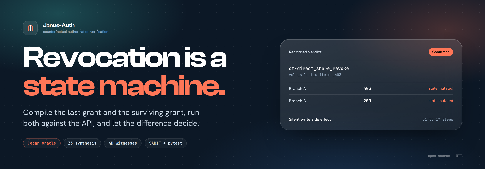
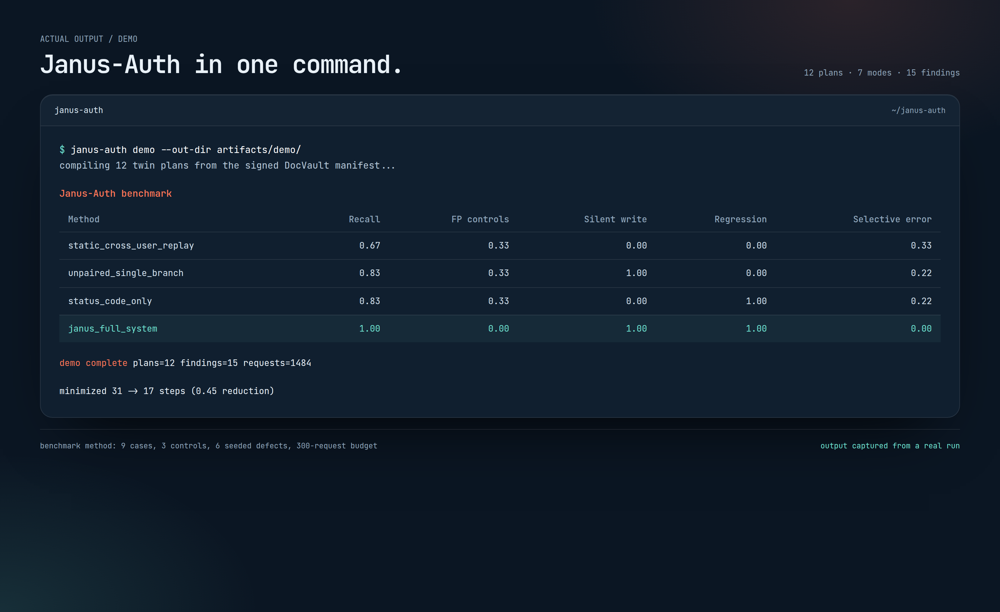
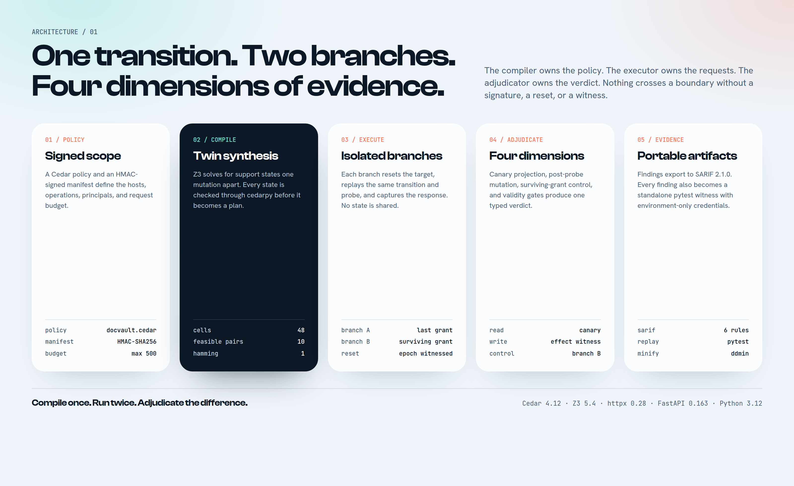
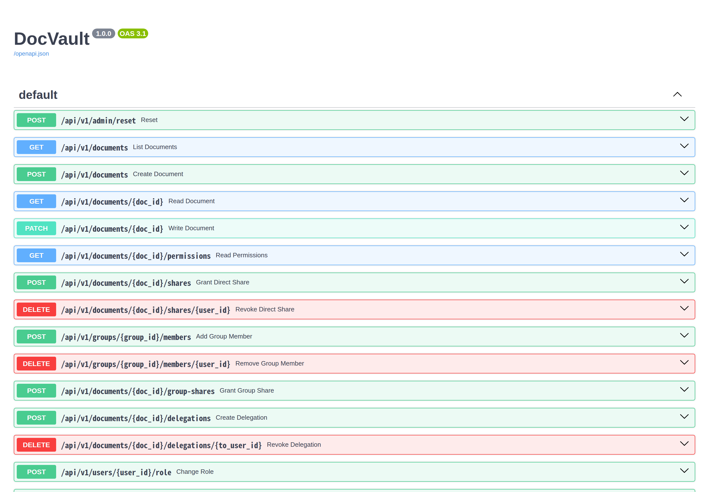
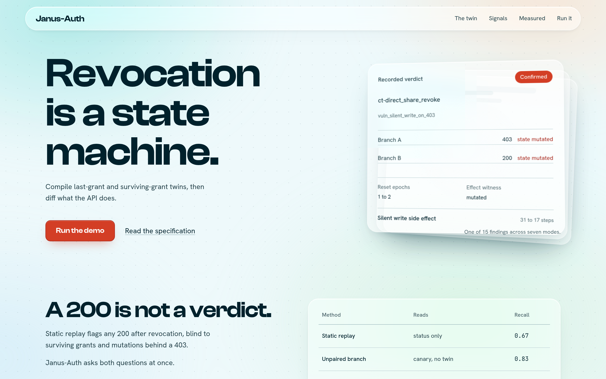

<p align="center">
  
</p>

<h1 align="center">Janus-Auth</h1>

<p align="center">
  <strong>Counterfactual authorization verification for API lifecycles.</strong><br>
  Compile the last grant and the surviving grant. Run both against the API. Adjudicate the difference.
</p>

<p align="center">
  <a href="https://www.python.org/downloads/"></a>
  <a href="https://github.com/jaaneeshwaran/janus-auth/actions/workflows/ci.yml"></a>
  <a href="https://docs.astral.sh/ruff/"></a>
  <a href="https://mypy-lang.org/"></a>
  
  <a href="LICENSE"></a>
  
</p>

<p align="center">
  
</p>

<br>

**Janus-Auth tests authorization revocations the way an attacker would: by running the same transition twice against two support states and comparing what the API actually exposes and mutates.** It is a small, typed Python package built around a Cedar oracle, a Z3 twin compiler, an isolated HTTP executor, and a four-dimensional adjudicator. It is designed for security engineers who need evidence, not a scanner score.

The project is an MVP. The scope is deliberately narrow: one reference target, seven enforcement modes, twelve compiled twin plans, and an evidence trail that ends in SARIF and standalone pytest witnesses.

---

## Why it exists

Most authorization testing stops at a status code. That is not enough to distinguish a real broken-object-level authorization (BOLA) bug from a masked public projection, a silent write that happened behind a `403`, or an over-broad revocation that destroyed a grant the policy still allows.

Janus-Auth makes those cases explicit:

- **Branch A** revokes the grant under test and expects `DENY`.
- **Branch B** preserves a surviving grant and expects `ALLOW`.
- Both branches run from independent resets with the same transition and probe.
- A canary read, a post-probe state witness, and the Branch B control decide the verdict.

The result is a typed verdict such as `CONFIRMED_VIOLATION` with a subtype such as `SILENT_WRITE_SIDE_EFFECT`, not a bare status code.

---

## What you get

| Capability | What it means in practice |
|---|---|
| **Counterfactual twins** | Z3 synthesizes feasible support states that differ by exactly one grant, permission, tenant, or role, and cross-checks every state through the authoritative Cedar evaluator. |
| **Four-dimensional adjudication** | Canary projection, post-probe state mutation, surviving-grant control, and validity gates produce `CONFORMS`, `CONFIRMED_VIOLATION`, `LEGITIMATE_ACCESS_REGRESSION`, `CONFORMS_MASKED`, `UNCERTAIN_ABSTAIN`, or `INVALID_TEST`. |
| **Isolated execution** | Every branch resets the target, records a monotonic epoch, and uses a fresh placeholder context. No state crosses the branch boundary. |
| **Reproducible evidence** | Findings export to SARIF 2.1.0 and to standalone pytest files that read credentials from the environment. |
| **Pair-preserving minimization** | A ddmin pass removes redundant setup and noise steps only when a fresh replay reproduces the same verdict and preserves Branch B. |
| **Measured baselines** | Static replay, an unpaired branch, and a status-code-only oracle are run against the same evidence to show what the extra dimensions buy. |

---

## The demo

The command below is the whole pipeline: compile, run seven modes, adjudicate, minimize, export SARIF, generate pytest witnesses, and print the benchmark table.

```bash
janus-auth demo --out-dir artifacts/demo/
```

The screenshot below is captured from a real run, not a mock.

<p align="center">
  
</p>

The demo reports:

- **12** compiled twin plans
- **7** target modes: `clean` plus six seeded defects
- **15** findings
- **31 → 17** steps in the minimized silent-write witness
- **1.00** defect recall and **0.00** false positives on controls for the full system

---

## How it works

<p align="center">
  
</p>

1. **Signed scope.** A Cedar policy and an HMAC-signed `ScopeManifest` define allowed hosts, operations, principals, rate limits, and the request budget.
2. **Twin synthesis.** Z3 enumerates the 48-cell decision grid, keeps the feasible pairs at Hamming distance 1, and rejects every state whose Cedar decision disagrees with the model.
3. **Isolated execution.** The runner resets the target before each branch, resolves placeholders from the signed extractors, and sends every request through `SafetyGatekeeper.validate_request()`.
4. **Adjudication.** The 4D adjudicator applies the truth table in `PROJECT_SPEC.md` §9.3.3 and records typed dimensions and both branch summaries.
5. **Evidence.** SARIF results and standalone pytest witnesses are written without credentials. Traces are redacted and encrypted at rest.

The full design is in [`docs/architecture.md`](docs/architecture.md).

---

## Install

Janus-Auth targets Python 3.12+.

```bash
python3.12 -m venv .venv
.venv/bin/python -m pip install --upgrade pip
.venv/bin/python -m pip install -e ".[dev]"
```

The reference target is a local FastAPI app. No Docker, database, or network service is required for the demo.

---

## Quick start

```bash
# 1. Check the policy, OpenAPI description, and manifest state.
.venv/bin/janus-auth validate

# 2. Produce an unapproved mapping proposal from the OpenAPI document.
.venv/bin/janus-auth propose-mapping --out configs/draft_mapping.yaml

# 3. Approve a copy of the manifest and sign it. Use a strong secret in production.
export JANUS_SIGNING_SECRET="$(python3 -c 'import secrets; print(secrets.token_urlsafe(32))')"
.venv/bin/janus-auth approve-manifest --approver you@example.org

# 4. Run the complete showcase.
.venv/bin/janus-auth demo --out-dir artifacts/demo/
```

`janus-auth demo` signs an in-memory copy of the reference manifest, so it can run without changing the committed `configs/docvault_manifest.yaml`. The committed manifest is intentionally `approved: false`; the compiler and runner refuse it until a human approval is recorded.

> **Note:** the signing secret is never written to the manifest, reports, SARIF, or replay files. `janus-auth` uses an insecure development fallback with a loud warning when `JANUS_SIGNING_SECRET` is unset. Set it outside local testing.

---

## CLI

| Command | What it does | Exit codes |
|---|---|---|
| `janus-auth validate` | Validate the OpenAPI document, Cedar policy, and manifest signature state. | `0` valid, `1` error |
| `janus-auth propose-mapping` | Propose operation mappings. Output is always `approved: false`. | `0` written, `1` error |
| `janus-auth approve-manifest` | Record an approver, set an expiry, HMAC-sign, rewrite, and re-verify. | `0` approved, `1` error |
| `janus-auth compile` | Compile the approved manifest into counterfactual twin plans. | `0` compiled, `1` error |
| `janus-auth run` | Execute plans, adjudicate, minimize, and export SARIF, JSON, and pytest witnesses. | `0` clean, `2` findings with `--fail-on-violation`, `1` error |
| `janus-auth benchmark` | Run the four-method benchmark and write JSON plus Markdown reports. | `0` complete, `1` error |
| `janus-auth demo` | Run the full compile, execute, adjudicate, minimize, and report showcase. | `0` complete, `1` error |

The complete option reference is in [`docs/cli.md`](docs/cli.md).

---

## Configuration

| Variable | Default | Purpose |
|---|---|---|
| `JANUS_SIGNING_SECRET` | insecure development fallback | HMAC key for `approve-manifest`, `compile`, `run`, and `benchmark`. Set a strong random value outside local testing. |
| `JANUS_TRACE_ENCRYPTION_KEY` | ephemeral per-session key | Fernet key for encrypted trace blobs. If unset, the process warns and traces cannot be decrypted later. |
| `JANUS_RETENTION_DAYS` | `7` | Trace retention in days. Expired verdicts are purged when the store opens. |
| `JANUS_Z3_TIMEOUT_MS` | `5000` | Per-query Z3 timeout. |
| `JANUS_MAX_REQUESTS` | `500` | Default run budget when `--budget` is omitted. |

---

## Benchmark

The benchmark runs the full system against three deliberately weaker methods on the same paired evidence.

| Method | Defect recall | FP on controls | Silent write | Regression | Selective error |
|---|---:|---:|---:|---:|---:|
| Static cross-user replay | 0.67 | 0.33 | 0.00 | 0.00 | 0.33 |
| Unpaired single branch | 0.83 | 0.33 | 1.00 | 0.00 | 0.22 |
| Status-code-only pair | 0.83 | 0.33 | 0.00 | 1.00 | 0.22 |
| **Janus-Auth full system** | **1.00** | **0.00** | **1.00** | **1.00** | **0.00** |

The benchmark covers nine cases: three clean controls and six seeded defects, under a 300-request budget. The methodology and reproduction commands are in [`docs/benchmark.md`](docs/benchmark.md).

---

## Security

Security is the product, so the tool is built to be hard to misuse:

- **Signed scope only.** The compiler and runner refuse manifests where `approved` is not `true` or the HMAC signature is invalid.
- **Mandatory gatekeeping.** Every outbound request, including reset, passes `SafetyGatekeeper.validate_request()`: scheme allowlist, host allowlist, SSRF checks for metadata/link-local/multicast/unspecified ranges, redirects disabled, request budget, and rate limit.
- **No hardcoded secrets.** Plans and replay witnesses reference symbolic principal aliases. Credentials come from the environment.
- **Redaction and encryption.** Headers and tokens are redacted before storage; trace blobs are encrypted with Fernet and expire on a retention schedule.
- **No unsafe deserialization.** YAML is read with `yaml.safe_load()` after a 5 MB ceiling. SQLite statements are parameterized.

See [`SECURITY.md`](SECURITY.md) for reporting and [`PROJECT_SPEC.md`](PROJECT_SPEC.md) for the binding security design.

---

## Reference target

The repository includes **DocVault**, a multi-tenant document service with seven switchable enforcement modes: one clean mode and six single-defect modes. It is a real FastAPI app, not a diagram.

<p align="center">
  
</p>

Start it directly with:

```bash
.venv/bin/uvicorn janus_auth.targets.docvault_app:app --host 127.0.0.1 --port 8000
```

## Project site

The repository also includes a static landing page with the same visual system. It is plain HTML and CSS, with no framework or build step.

<p align="center">
  
</p>

Open `site/index.html` directly, or serve the directory with any static file server.

---

## Project structure

```text
janus-auth/
├── .github/                 # CI, issue templates, pull request template
├── assets/                  # README visuals and diagrams
├── configs/                 # Cedar policy, signed scope manifest, OpenAPI document
├── docs/                    # Architecture, CLI, benchmark, and security notes
├── site/                    # Static project landing page
├── src/janus_auth/
│   ├── compiler/            # Mapper, Z3 synthesis, twin compiler
│   ├── oracle/              # Cedar evaluator and 4D adjudicator
│   ├── runner/              # Isolated executor and pair-preserving minimizer
│   ├── security/            # Gatekeeper, redactor, encrypted trace store
│   ├── reporting/           # SARIF and pytest witness generation
│   ├── targets/             # DocVault reference target
│   ├── benchmark/           # Baselines and evaluation
│   └── cli.py               # Typer command surface
├── tests/                   # Unit, integration, and security tests
├── PROJECT_SPEC.md          # Binding specification
└── spec-compliance/         # Requirement-by-requirement audit
```

---

## Documentation

- [Architecture](docs/architecture.md)
- [CLI reference](docs/cli.md)
- [Benchmark methodology](docs/benchmark.md)
- [Security model](SECURITY.md)
- [Specification](PROJECT_SPEC.md)
- [Compliance audit](spec-compliance/REPORT.md)
- [Contributing](CONTRIBUTING.md)
- [Changelog](CHANGELOG.md)

---

## Roadmap

The MVP is complete. The next useful steps are:

- Publish the package to PyPI and add a signed release workflow.
- Add a second live target beyond DocVault.
- Replace the heuristic mapper with a bring-your-own-model adapter while keeping `approved: false` as the hard boundary.
- Add a Schemathesis-driven OpenAPI contract suite.
- Run CI across Python 3.12, 3.13, and 3.14.
- Provide a clean Cedar AST fallback for environments where the `cedarpy` wheel is unavailable.

These are planned directions, not shipped features.

---

## Contributing

Issues and pull requests are welcome. Start with [`CONTRIBUTING.md`](CONTRIBUTING.md), run the local gates, and keep changes focused:

```bash
.venv/bin/ruff check src/ tests/
.venv/bin/mypy src/
.venv/bin/pytest -q
```

For security issues, do not open a public issue. Use the process in [`SECURITY.md`](SECURITY.md).

---

## License

MIT. See [`LICENSE`](LICENSE).

---

<p align="center">
  <sub>Built to make revocation claims falsifiable.</sub>
</p>