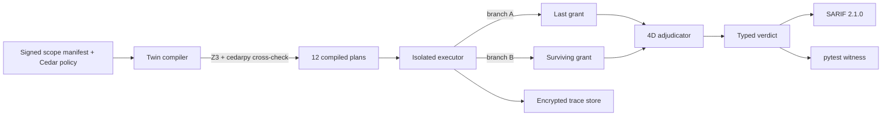

# Architecture

Janus-Auth is a small pipeline with a hard boundary between policy, execution, and adjudication. This document describes the moving parts, the invariants they enforce, and the limits of the MVP.

For the binding requirements, read [`PROJECT_SPEC.md`](../PROJECT_SPEC.md). This page explains how the code realizes them.

## The shape of the system

## Components

### `janus_auth.models`

Typed Pydantic v2 models for every artifact that crosses a module boundary: `ScopeManifest`, `MappingProposal`, `CounterfactualPairPlan`, `ApiStep`, `BranchTrace`, `PairedExecutionEvidence`, `AdjudicationReport`, and the enums that constrain them. External inputs use strict validation with `extra="forbid"` where the boundary is untrusted.

### `janus_auth.security`

- **`gatekeeper.py`** validates every outbound request against the signed manifest: scheme, hostname allowlist, SSRF checks, redirects, request budget, rate limit, and destructive-method declarations. It also enforces the signed-manifest policy hash.
- **`redactor.py`** scrubs `Authorization`, `Cookie`, `Set-Cookie`, `X-Api-Key`, and JWT-shaped values before any trace is stored.
- **`store.py`** is a SQLite trace store. It encrypts evidence blobs with Fernet, purges expired rows on open, and uses parameterized statements throughout.

### `janus_auth.oracle`

- **`cedar_engine.py`** is the authoritative policy evaluator. It uses `cedarpy` and raises on unknown principals, entities, actions, or contexts rather than guessing.
- **`adjudicator.py`** implements the four-dimensional truth table in `PROJECT_SPEC.md` §9.3.3. It is a pure function unless a `TraceStore` is supplied.

### `janus_auth.compiler`

- **`mapper.py`** proposes operation mappings from the OpenAPI document and the Cedar action names. Its output is always `approved: false`.
- **`z3_synthesizer.py`** enumerates the 48-cell decision grid, solves for feasible support states, enforces Hamming distance 1, and cross-checks every state through Cedar.
- **`compiler.py`** turns each feasible pair into two `ApiStep` sequences, adds the masked control and the delegation-cascade realization, and produces twelve deterministic plans.

The synthesis outcome is pinned by tests: 10 feasible pairs, 38 reasoned infeasible obligations, 48 total cells.

### `janus_auth.runner`

- **`executor.py`** runs one branch at a time. It resets the target, resolves placeholders from the signed extractors, sends every request through the gatekeeper, and records redacted `StepObservation` objects. Branch A and Branch B never share a placeholder context or target state.
- **`minimizer.py`** runs Zeller-style ddmin over shared setup steps. A removal is accepted only when a fresh replay reproduces the exact verdict and subtype and preserves the Branch B control. Essential structural steps are never candidates.

### `janus_auth.reporting`

- **`sarif.py`** exports confirmed findings and access regressions as SARIF 2.1.0 with six rules, both branch summaries, and policy/manifest locations.
- **`replay_codegen.py`** generates standalone pytest files with the required test names and environment-only credentials.

### `janus_auth.targets`

`docvault_app.py` is the reference target: a FastAPI service with fifteen paths, sixteen operations, five synthetic principals, a masked public projection, and seven enforcement modes. Each `vuln_*` mode injects exactly one lifecycle defect.

### `janus_auth.benchmark`

`baselines.py` implements static cross-user replay, an unpaired single-branch ablation, and a status-code-only pair. `evaluator.py` runs all methods over the same evidence and computes recall, false positives, silent-write detection, regression detection, coverage, selective error, and average witness length.

## The execution contract

For every compiled plan:

1. **Reset.** Branch A resets the target and records the epoch. Branch B resets again and must observe a later epoch. No state is shared.
2. **Setup.** Each branch replays its setup steps. The transition and probe are identical between branches; the only intended difference is the surviving-grant support.
3. **Probe.** The probe is sent through the gatekeeper with the same method, path, body, and principal in both branches.
4. **Effect witness.** A post-probe read by the document owner records whether protected state was mutated.
5. **Validity.** The branch is valid only when the reset, pre-transition witness, transition acknowledgement, post-transition witness, probe, and effect witness all succeed.
6. **Adjudication.** The adjudicator applies the read or write branch of the truth table, then the surviving-grant control.

If a reset cannot be proven or a precondition is missing, the branch is marked invalid and the plan yields `INVALID_TEST` rather than a finding.

## Four dimensions

The adjudicator does not treat a status code as proof. It combines:

1. **Validity gate** — did the branch actually execute the intended transition?
2. **Read projection** — did Branch A return the protected canary when it should have been denied?
3. **Post-probe state mutation** — did a denied write still change the document?
4. **Surviving-grant control** — did Branch B retain the access the policy still allows?

The Branch B control is what separates a real leak from a masked public projection and a real over-revocation from an intended denial.

## Evidence model

A report contains:

- the typed verdict and violation subtype;
- four typed `DimensionFinding` records;
- both `BranchSummary` records (status, canary presence, access, state mutation);
- the reset epochs;
- `reproduction_verified`.

SARIF results carry the same information in a tool-consumable form. Replay witnesses embed the plan steps and the observed outcome, not credentials.

## Security boundaries

- The compiler and runner refuse manifests that are not approved and correctly signed.
- Every request passes the gatekeeper, including reset.
- `allow_destructive` is false by default; DELETE is limited to declared transition endpoints and reset.
- The trace store encrypts evidence at rest and redacts headers before storage.
- The AI boundary is non-authoritative: `propose-mapping` always emits `approved: false`, and the runner never treats a proposal as approval.

## Limitations

- The reference target is in-process. Live HTTP execution is supported by passing `--target-url`, but the target host must be present in the signed manifest allowlist.
- The mapper is heuristic. It is a starting point for human review, not an authorization oracle.
- The optional AST fallback for `cedarpy` is not implemented; the MVP requires the wheel.
- The benchmark covers one target and one defect catalogue. It is a measured baseline, not a universal claim.

## Where to go next

- [CLI reference](cli.md)
- [Benchmark methodology](benchmark.md)
- [Security policy](../SECURITY.md)
- [Compliance audit](../spec-compliance/REPORT.md)